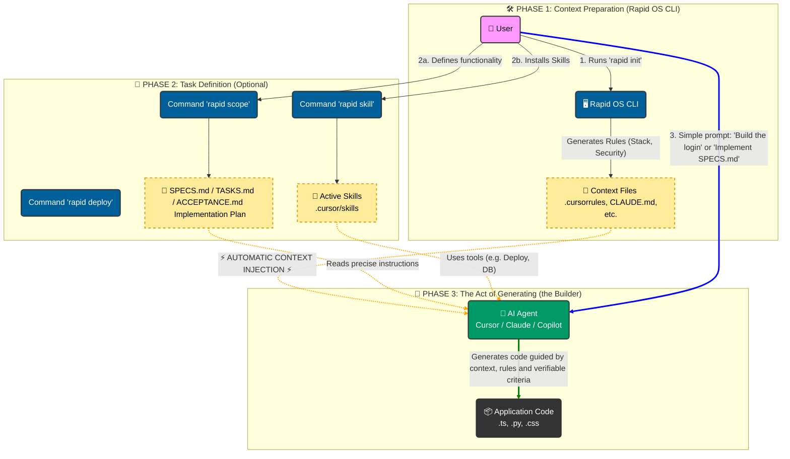

<a name="readme-top"></a>

<div align="center">

# ⚡ Rapid OS

### Context Injection for AI Engineering

Turn your agents (Cursor, Claude, Antigravity, VS Code and Codex) into Senior Engineers instantly.

</div>

<details>
  <summary>Table of Contents</summary>
  <ol>
    <li><a href="#about-the-project">📖 About the Project</a></li>
    <li><a href="#rapid-os-v3-status">Rapid OS v3.1.0 Status</a></li>
    <li><a href="#how-it-works">🧩 How it Works</a></li>
    <li>
      <a href="#build-with">⚒️ Build With</a>
      <ul>
        <li><a href="#tech-stack">Tech Stack</a></li>
        <li><a href="#key-features">Key Features</a></li>
      </ul>
    </li>
    <li>
      <a href="#getting-started">💻 Getting Started</a>
      <ul>
        <li><a href="#setup">Setup</a></li>
        <li><a href="#prerequisites">Prerequisites</a></li>
        <li><a href="#install">Install</a></li>
        <li><a href="#update">Update</a></li>
      </ul>
    </li>
    <li><a href="#quick-start-shortcuts">Quick start with shortcuts</a></li>
    <li><a href="#usage">Usage</a></li>
    <li><a href="#run-tests">Run tests</a></li>
    <li><a href="#deployment">Deployment</a></li>
    <li><a href="#authors">👥 Authors</a></li>
    <li><a href="#future-features">Future v3.2+ Enhancements</a></li>
    <li><a href="#contributing">🤝 Contributing</a></li>
    <li><a href="#show-your-support">⭐ Show your Support</a></li>
    <li><a href="#acknowledgements">👏 Acknowledgements</a></li>
    <li><a href="#faq">❓ FAQ</a></li>
    <li><a href="#license">📃 License</a></li>
  </ol>
</details>

---

## 📖 About the Project <a name="about-the-project"></a>

**Rapid OS** is a **Contract-Driven Engineering OS** and a **Context Injection and Governance** framework designed to solve the **"Context Amnesia"** problem and the lack of deterministic verification in AI coding agents.

When you work with AI assistants such as Cursor, Claude, Antigravity, VS Code or Codex, Rapid OS does not just inject a standardized **"Project Constitution"**: it governs the full engineering cycle — repository intelligence (`rapid scan`), immutable specifications (`rapid spec`), selective context compilation (`rapid context`), execution contracts and policies (`rapid policy` / `rapid run`), harness capability profiles and compatibility (`rapid harness`), immutable evidence (`rapid evidence`) and deterministic behavioral evaluation (`rapid eval`).

**🌐 Official Documentation Portal**: [https://alyconr.github.io/Rapid-OS/](https://alyconr.github.io/Rapid-OS/)

### 📚 Canonical Documentation Suite (`v3.1.0`)

The public portal includes the complete documentation, organized into the following areas:

- **Learn and Get Started**:
  - [What is Rapid OS](https://alyconr.github.io/Rapid-OS/concepts/what-is-rapid-os) · [Why Rapid OS](https://alyconr.github.io/Rapid-OS/concepts/why-rapid-os)
  - [Installation Guide](https://alyconr.github.io/Rapid-OS/installation) · [Getting Started](https://alyconr.github.io/Rapid-OS/getting-started)
  - [Shortcuts per harness (`/rapid-<mode>`)](https://alyconr.github.io/Rapid-OS/guides/shortcuts)
  - [Engineering Modes (Feature, Bugfix, Refactor, Hardening, Research)](https://alyconr.github.io/Rapid-OS/guides/modes)
  - [Real-World Use Cases](https://alyconr.github.io/Rapid-OS/guides/use-cases)
- **Reproducible Hands-on Labs (Tutorials)**:
  - [Lab Catalog](https://alyconr.github.io/Rapid-OS/tutorials)
  - [Feature Lab](https://alyconr.github.io/Rapid-OS/tutorials/feature-lab)
  - [Bugfix Lab](https://alyconr.github.io/Rapid-OS/tutorials/bugfix-lab)
  - [Refactor Lab](https://alyconr.github.io/Rapid-OS/tutorials/refactor-lab)
  - [Hardening Lab](https://alyconr.github.io/Rapid-OS/tutorials/hardening-lab)
  - [Research Lab](https://alyconr.github.io/Rapid-OS/tutorials/research-lab)
  - [Manual walkthrough with v3 commands (advanced)](https://alyconr.github.io/Rapid-OS/tutorials/first-governed-project)
- **Coding Harness Integrations**:
  - [Codex](https://alyconr.github.io/Rapid-OS/integrations/codex) · [Claude Code](https://alyconr.github.io/Rapid-OS/integrations/claude-code)
  - [Cursor](https://alyconr.github.io/Rapid-OS/integrations/cursor) · [VS Code](https://alyconr.github.io/Rapid-OS/integrations/vscode) · [Google Antigravity](https://alyconr.github.io/Rapid-OS/integrations/antigravity)
- **Governance and Cookbooks**:
  - [Execution Policies and Contracts](https://alyconr.github.io/Rapid-OS/cookbooks/policies-and-contracts)
  - [Harness Profiles and Capabilities](https://alyconr.github.io/Rapid-OS/cookbooks/harness-profiles)
  - [Evidence Engine](https://alyconr.github.io/Rapid-OS/cookbooks/evidence-engine)
  - [Deterministic Behavioral Evaluations](https://alyconr.github.io/Rapid-OS/cookbooks/behavioral-evaluations)
  - [CI/CD Integration](https://alyconr.github.io/Rapid-OS/guides/ci-cd-integration)
- **Operations, Release and Audit**:
  - [Deployment Procedure](https://alyconr.github.io/Rapid-OS/operations/documentation-deployment)
  - [Rollback Procedure](https://alyconr.github.io/Rapid-OS/operations/documentation-rollback)
  - [Maintenance and Versioning](https://alyconr.github.io/Rapid-OS/operations/documentation-maintenance)
  - [RAPIDxxx Diagnostics](https://alyconr.github.io/Rapid-OS/troubleshooting/diagnostics) · [CLI Reference](https://alyconr.github.io/Rapid-OS/cli)
  - [v3 Architecture](https://alyconr.github.io/Rapid-OS/architecture/rapid-os-v3) · [Orchestration Architecture](https://alyconr.github.io/Rapid-OS/architecture/orchestration) · [Release v3.1.0](https://alyconr.github.io/Rapid-OS/release-v3.1.0) · [Release v3.0.0](https://alyconr.github.io/Rapid-OS/release-v3.0.0) · [Changelog](CHANGELOG.md)

<p align="right">(<a href="#readme-top">back to top</a>)</p>

## Rapid OS v3.1.0 Status <a name="rapid-os-v3-status"></a> <a name="rapid-os-v2-status"></a>

> **Development version.** `main` is at `3.2.0.dev0`; the stable version is still `v3.1.1` (the installers and the installation docs point to that tag). What `main` adds on top of the stable release: onboarding through `rapid setup` / `/rapid-init` with one stack per component and documents you review before closing, per-stack architecture with the `gate.architecture` gate (`rapid arch check`), infrastructure services and the deployment document, the security baseline (OWASP ASVS 5.0.0, SSDF, SLSA) with a per-language CI workflow, and `rapid shortcuts install --global` for user-level `/rapid-init`. See the [CHANGELOG](CHANGELOG.md).

Rapid OS `v3.1.0` is complete and preserves full backward compatibility with all v3.0 and v2 commands and generated file locations. It adds the porcelain layer, the five engineering modes, shortcuts and Claude Code hooks on top of the v3 governance engine.

| Workstream | Status | Included in v3.1.0 |
| :-- | :-- | :-- |
| Core package & PEP 517 packaging | Complete | `rapid_os` package, `rapid` console script, `rapid.py` compatibility entrypoint, and `rapid --version`. |
| Agent adapter architecture | Complete | Cursor, Claude, Antigravity, VS Code, and Codex adapters behind a registry. |
| First-class Codex support | Complete | Opt-in `AGENTS.md` generation through the adapter system. |
| Structured scope generation | Complete | `SPECS.md`, `TASKS.md`, and `ACCEPTANCE.md` from `rapid scope`. |
| Validation and diagnostics | Complete | `rapid validate`, `rapid doctor`, and `rapid inspect-context` across all v2 and v3 registries. |
| Project Intelligence (v3 Phase 1) | Complete | Deterministic `ProjectModel`, `ProjectFact`, `Evidence` provenance, `rapid scan` (`--json`, `--write`, `--verbose`), and optional `.rapid-os/project.json` snapshot. |
| Context Compiler (v3 Phase 2) | Complete | Task-aware `ContextCompiler`, `ContextResolver`, `ContextManifest`, budget enforcement, conflict detection, `RAPID7xx` diagnostics, and read-only `rapid context` (`--mode`, `--harness`, `--objective`, `--spec`, `--spec-revision`, `--max-chars`, `--manifest`, `--json`). |
| Spec Registry (v3 Phase 3) | Complete | Canonical `SpecRecord` & `SpecRevision`, immutable revisions under `.rapid-os/specs/<id>/`, `rapid spec` (`create`, `list`, `show`, `revise`, `status`, `export-legacy`), `RAPID8xx` validation, and `rapid context --spec` integration. |
| Execution Policy Engine & Run Contract (v3 Phase 4) | Complete | Deterministic `ExecutionPolicy`, `PolicyDecision`, `ExecutionContract`, immutable `RunRecord` & `RunState` ledger under `.rapid-os/runs/<run-id>/`, `rapid policy` (`show`, `init`), `rapid run` (`create`, `list`, `show`, `status`, `task`, `gate`), and `RAPID1000–RAPID1014` validation. |
| Harness Capability Registry (v3 Phase 5) | Complete | Canonical capability catalog, conservative builtin & project `HarnessProfile` overrides (`.rapid-os/harnesses/<id>.json`), deterministic `CapabilityRequirementResolver` & `CapabilityResolver`, `.rapid-os/capabilities.lock`, `rapid harness` (`list`, `show`, `init`, `lock`, `resolve`), and `RAPID1100–RAPID1112` validation. |
| Evidence Engine & Behavioral Evals (v3 Phase 6) | Complete | Immutable `RunEvidence` records & copied SHA-256-verified artifacts (`.rapid-os/evidence/<run-id>/`), deterministic `BehavioralEvaluator` & append-only `EvaluationReport` ledger (`.rapid-os/evals/<run-id>/`), `rapid evidence` (`list`, `show`, `add`, `verify`), `rapid eval` (`run`, `list`, `show`), and `RAPID1200–RAPID1229` validation. |
| Porcelain layer (v3.1) | Complete | `rapid start`, `next`, `check`, `task`, `attach`, `finish`, `approve`, `status` and `abort` drive a governed run on top of the plumbing; a pure Conductor asks the `BehavioralEvaluator` what is missing; `.rapid-os/session.json` remembers the active run. |
| Behavioral ruleset v2 (v3.1) | Complete | `rapid check --expect fail` (`expectation: "fail"` produces a `reproduction.<task>` assertion) and `harness:*` producers can no longer close human gates; `--ruleset 1` remains available and v1 reports stay valid. |
| Engineering modes (v3.1) | Complete | Playbooks for `feature`, `bugfix`, `refactor`, `hardening` (isolated worktree with `rapid start --worktree`) and `research` (`rapid attach`). |
| Shortcuts (v3.1) | Complete | `rapid shortcuts install\|list\|remove` and `rapid init --shortcuts` generate nine shortcuts (`/rapid-init` plus one per mode and three helpers) for Claude Code, Codex, Antigravity, Cursor and VS Code; `RAPID1321` warns about overlapping folders. |
| Claude Code hooks (v3.1) | Complete | `rapid hook stop\|pre-tool` installed with `--hooks`: keep the agent working until a person is needed and deny reserved commands and edits inside `.rapid-os/`. |
| Hardened human approval (v3.1) | Complete | `rapid approve` requires a TTY, refuses agent sessions and Claude Code ancestors (`RAPID1310`), and supports `--waive` / `--reject`. Best-effort: see the known limits in the release notes. |
| MCP abstraction | Complete | Structured MCP model with editor-specific rendering and package metadata. |
| Testing and CI hardening | Complete | GitHub Actions on Python 3.10, 3.11, 3.12 & 3.13 running `unittest`, CLI smoke checks, `python -m build` artifact checks, and clean wheel + sdist installation tests. |

<p align="right">(<a href="#readme-top">back to top</a>)</p>

## 🧩 How it Works <a name="how-it-works"></a>

Rapid OS acts as the **Architect** who defines the rules, while your AI (Cursor/Claude) acts as the **Builder**.



<p align="right">(<a href="#readme-top">back to top</a>)</p>

## ⚒️ Build With <a name="build-with"></a>

### Tech Stack <a name="tech-stack"></a>

This project is built with native technologies to ensure maximum compatibility and zero heavy dependencies:

- **Core Logic**
- **Installer (Linux/Mac)**
- **Installer (Windows)**
- **Templates & Context**

### Key Features <a name="key-features"></a>

- **🧰 Hybrid Skills Manager**: Installs active capabilities for your AI from two sources:
  - _Remote_: Direct access to the community ecosystem (`npx skills`) to install thousands of tools.
  - _Local_: Use your own private templates (`templates/skills`) to standardize your team's workflows.
- **🤖 Modular Multi-Agent**: No more noise. Choose exactly which configuration files to generate: Cursor (`.cursorrules`), Claude Code (`CLAUDE.md`), Google Antigravity (`.agent/rules`), VS Code (`INSTRUCTIONS.md`) or Codex (`AGENTS.md`). Generation uses internal adapters to keep each agent isolated and ready to grow without changing your commands.
- **🧠 Smart Business Context**: Business rules live in `docs/BUSINESS_RULES.md`: pasted by you, drafted by the agent or skipped, always with their provenance visible (an agent draft enters the context as an assumption until you confirm it). No reusable templates.
- **🏗️ Architectural Topologies**: Define whether your project is Frontend Only, BaaS (Supabase), Separated Fullstack or **Documentation Site** to avoid code hallucinations.
- **🔌 MCP Tools (Model Context Protocol)**: Automatically configures database servers (Postgres/Supabase) and research tools (Context7, Firecrawl).
- **🖼️ Visual Reference Context (Vision)**: Records screenshots in `references/` together with a human description in `references/VISION_CONTEXT.md` and reassembles the agents' context.
- **🚀 Senior Stacks**: Pre-configured templates for Modern Web, Python AI, Creative Frontend, **Docusaurus Docs**, etc.
- **🛡️ Secure by Default**: Automatic injection of OWASP protocols and Anti-PII rules.
- **☁️ Deployment Guides**: `rapid deploy --target <platform>` prints the local template (`templates/deploy/<platform>.md`: `aws`, `azure`, `vercel`, `render`, `railway`, `dokploy`) without writing anything; the project document is `docs/DEPLOYMENT.md`, optional during onboarding.

<p align="right">(<a href="#readme-top">back to top</a>)</p>

## 💻 Getting Started <a name="getting-started"></a>

Follow these steps to install Rapid OS in your local environment.

### Setup <a name="setup"></a>

You do not need to clone this repository manually to use the tool. The installer takes care of everything.

### Prerequisites <a name="prerequisites"></a>

Make sure you have the following installed:

- **Git**: For version control.
- **Python 3.10+**: To run the Rapid OS governance core (`3.10`, `3.11`, `3.12`, `3.13` verified in CI; standard library with no mandatory external dependencies).
- **Node.js (Optional)**: Required only if you want to install remote Skills using `npx` (`rapid skill add`).

### Install <a name="install"></a>

#### Stable Release (`v3.1.1`)

Once the stable tag `v3.1.1` is published, use the installers pinned to that reproducible release:

- **Option A: Standard Python package installation (`pip` / `venv`) at tag `v3.1.1`**:
  ```bash
  git clone --branch v3.1.1 https://github.com/alyconr/Rapid-OS.git
  cd Rapid-OS
  python -m pip install .
  rapid --version
  ```
- **Option B: Linux, macOS or WSL (Stable `v3.1.1`)**:
  ```bash
  curl -sL https://raw.githubusercontent.com/alyconr/Rapid-OS/v3.1.1/install.sh | bash
  ```
- **Option C: Windows PowerShell (Stable `v3.1.1`)**:
  ```powershell
  irm https://raw.githubusercontent.com/alyconr/Rapid-OS/v3.1.1/install.ps1 | iex
  ```

Restart your terminal after installation to load the `rapid` command and verify with `rapid --version` (`Rapid OS 3.1.1`).

#### Development (`latest development version` on `main`)

If you want to try in-development changes from the `main` branch (not pinned to a stable release):

```bash
git clone https://github.com/alyconr/Rapid-OS.git
cd Rapid-OS
git checkout main
python -m pip install -e .
```

<p align="right">(<a href="#readme-top">back to top</a>)</p>

### Update <a name="update"></a>

#### Update to the stable version `v3.1.1`

- **Windows PowerShell (Stable `v3.1.1`)**:
  ```powershell
  git -C "$HOME\.rapid-os" fetch --tags --force origin
  git -C "$HOME\.rapid-os" checkout --detach v3.1.1
  ```
  Or by running the stable installer:
  ```powershell
  irm https://raw.githubusercontent.com/alyconr/Rapid-OS/v3.1.1/install.ps1 | iex
  ```
- **Linux, macOS or WSL (Stable `v3.1.1`)**:
  ```bash
  git -C "$HOME/.rapid-os" fetch --tags --force origin
  git -C "$HOME/.rapid-os" checkout --detach v3.1.1
  ```
  Or by running the stable installer:
  ```bash
  curl -sL https://raw.githubusercontent.com/alyconr/Rapid-OS/v3.1.1/install.sh | bash
  ```

#### Update a development environment (`latest development version` on `main`)

If you are working on a development checkout of `main`:

```bash
git checkout main
git pull --ff-only origin main
rapid doctor
```

<p align="right">(<a href="#readme-top">back to top</a>)</p>

## ⚡ Quick start with shortcuts <a name="quick-start-shortcuts"></a>

The main Rapid OS workflow is **shortcuts**: one `/rapid-<mode>` command per engineering mode that your coding agent runs to carry the work from start to finish inside a governed run.

```bash
rapid shortcuts install --global --harness claude   # 1. once: the shortcuts in all your projects (the installer asks you)
rapid init --shortcuts                              #    or, in VS Code / to version them with the repo: in each project
```

```text
/rapid-init invoicing API for small businesses               # 2. onboarding driven by your agent (Codex: $rapid-init)
/rapid-feature add CSV export to the monthly report          # 3. Claude Code, Cursor, Antigravity, VS Code
$rapid-feature add CSV export to the monthly report          #    Codex
```

- `/rapid-init` drives onboarding with `rapid setup` (user-level since 3.2.0 with `rapid shortcuts install --global --harness <id>`). There is one shortcut per mode (`/rapid-feature`, `-bugfix`, `-refactor`, `-hardening`, `-research`) and three helpers (`/rapid-next`, `/rapid-status`, `/rapid-approve`).
- The agent follows the loop `rapid next --json` → `rapid start` → `rapid task` / `rapid check` → `rapid finish`, and stops when a person is needed. Then you run the command it gives you in **your terminal** (for example `rapid approve gate.final-verification`) and type `/rapid-next` to close: the agent never approves, aborts or edits `.rapid-os/`.
- Per-harness details (generated folder and invocation), human approval and common errors: [Shortcuts per harness](https://alyconr.github.io/Rapid-OS/guides/shortcuts).
- The v3 commands (`rapid spec`, `rapid run`, `rapid evidence`, `rapid eval`…) remain available as **Advanced mode** for CI, debugging and auditing: see the [CLI Command Reference](#cli-reference).

<p align="right">(<a href="#readme-top">back to top</a>)</p>

## Usage <a name="usage"></a>

### 1. Initialize a Project (New or Legacy)

`rapid init` is the universal command. Use it both for projects from scratch and to "heal" existing projects suffering from **Context Amnesia**.

1.  Open your terminal at the **root of your project**.
2.  Run:
    ```bash
    rapid init
    ```
3.  Follow the interactive wizard:
    - **Safe scanner**: Rapid OS checks local signals such as `package.json`, `tsconfig.json`, Docker, tests, monorepo, database and deploy provider to suggest a stack/topology. Nothing is applied without confirmation.
    - **Tech Stack**: Defines the allowed technologies (e.g. "Only React Functional Components").
    - **Archetype**: "Corporate" for strict code with tests, or "MVP" for speed.
    - **Project documentation**: For each document (brief, business rules, data model and architecture) you choose: 1) paste or import a file, 2) write it right there, 3) leave it for your agent (`/rapid-init`) or 4) skip it. With `--business-file <path>` you import the business rules without being asked.
    - **Research Capabilities**: Enables `Context7` (Docs) and `Firecrawl` (Web Scraping) so your AI can research libraries and websites by itself.

> **For Refactoring**: When you run this on a legacy project, Rapid OS injects a `.cursorrules` or `.agent` file that forces the AI to respect the new standards in any future refactoring, preventing it from imitating the old code ("code drift").

To keep the previous manual flow, use:

```bash
rapid init --no-scan
```

If you pass `--stack`, that value takes precedence over any scanner suggestion:

```bash
rapid init --stack nextjs
```

You can also set the archetype directly from the CLI (`mvp` or `corporate`) without an interactive prompt:

```bash
rapid init --archetype corporate
rapid init --archetype mvp
```

### 2. Rule Refinement (Rapid Refine)

If you feel your Agent (Cursor/Claude) ignores or misreads your rules, use `rapid refine` to improve the documentation with the help of the AI.

1.  Identify the problematic rules file (e.g. `docs/BUSINESS_RULES.md`).
2.  Run:
    ```bash
    rapid refine docs/BUSINESS_RULES.md
    ```
3.  **Copy the Mega-Prompt** that appears in your terminal.
4.  **Paste it into your Chat** with the AI.
5.  The AI will return a professional, unambiguous version of your rules. Replace the file's content with this new version.

### 3. Install Skills (Active Capabilities)

Give your agent tools to run complex tasks (e.g. query databases, browse the web).

```bash
# Option A: From the Marketplace (Vercel)
rapid skill add vercel-labs/agent-skills

# Option B: Your team's private templates
rapid skill install my-internal-workflow
```

If you run `rapid skill` with no arguments, Rapid OS opens an interactive menu to list, install a local template, add a remote skill or exit without changes.

### 4. Define Scope and Refactorings

Avoid giving the AI vague instructions like _"Improve the code"_. Use the **Scope Assistant**.

```bash
rapid scope
```

- Select the mode: **new feature**, **refactor**, **bugfix** or **legacy hardening**.
- Answer questions about business, scope, actors, flow, edge cases, rules, constraints, data impact, acceptance criteria, tests and tasks.
- Rapid OS generates `SPECS.md`, `TASKS.md` and `ACCEPTANCE.md` optimized for spec-guided implementation.
- **Your Final Prompt**: _"Implement the plan detailed in SPECS.md step by step and validate against ACCEPTANCE.md."_

### 5. Configure Database Tools (MCP)

If your architecture includes a database, generate the drivers so the AI can run real SQL and see tables:

```bash
rapid mcp --ide claude --scope project
```

(Supports Postgres and Supabase automatically).

Additional examples:

```bash
rapid mcp --ide codex --scope project
rapid mcp --ide codex --scope global
rapid mcp --ide claude --scope global
rapid mcp --ide cursor --scope project
rapid mcp --ide vscode --scope project
rapid mcp --ide antigravity --scope global
```

Rapid OS models MCP servers internally and then renders each editor's specific format:

- Codex -> `.codex/config.toml` with `mcp_servers` blocks
- Claude -> `.mcp.json` or `~/.claude.json` with `mcpServers`
- Cursor -> `.cursor/mcp.json` or `~/.cursor/mcp.json` with `mcpServers`
- VS Code -> `.vscode/mcp.json` with `servers`
- Antigravity -> `~/.gemini/antigravity/mcp_config.json` with a conservative JSON structure based on `mcpServers`

If the project has not been initialized with `rapid init` yet, `rapid mcp` offers to create only the minimal structure needed to generate MCP, or to cancel without writing files.

If you omit `--ide` or `--scope`, Rapid OS enters interactive mode and lets you choose the target and scope before writing the file.

### 6. Visual Reference Context (Vision)

Register a visual reference for the project to accompany your rules with interface context:

```bash
rapid vision path/to/design.png
```

`rapid vision` copies the image into `references/`, asks for a human description of the design, adds the entry to `references/VISION_CONTEXT.md` and regenerates the context files of the configured agents. If you run `rapid vision` without a path, the command asks for the path interactively and lets you cancel with `0`, `q`, `quit`, `exit`, `salir` or `cancelar`.

### 7. Documentation with Docusaurus

Rapid OS includes a specialized stack for creating modern documentation sites:

```bash
rapid init --shortcuts
# and in your agent: /rapid-init (or rapid setup next)
# Stack: docs-modern (componente docs)
# Topology: doc-site
```

Or from the terminal, without an agent: `rapid setup set topology doc-site` and `rapid setup set stack docs-modern`.

**Includes:**

- **Framework**: Docusaurus 3+ (Static Site Generator).
- **Language**: TypeScript and MDX (Markdown with React components).
- **Diagrams**: Native Mermaid.js support (flowcharts, sequence, GANTT).
- **Search**: Configuration ready for Algolia DocSearch or local search.
- **Versioning**: Folder structure optimized for semantic documentation versioning.
- **Topology**: `doc-site` organizes your project with specific folders for `docs`, `blog`, `src/components` and `static` assets.

### 🧩 Business Rules (`docs/BUSINESS_RULES.md`)

Your project's business rules live in `docs/BUSINESS_RULES.md`, the equivalent of your project's "Constitution". Rapid OS writes the file with a frontmatter (`rapid-doc`, `source`, `status`, `sha256`) that says who authored it:

- **Provided by you** (`source: provided`): saved as-is and counts as confirmed.
- **Drafted by the agent** (`source: drafted`): stays as a draft and reaches the context marked as an assumption until you confirm it with `rapid setup doc business --confirm`.
- **Skipped**: the agent receives the line `Reglas de negocio: sin definir. Pregunta, no inventes.`

A good document defines: what problem you solve and why people should buy from you, how you acquire, activate and retain customers, and how you generate revenue (SaaS, E-com, etc.).

> **Legacy**: `.rapid-os/standards/business.md` (from earlier versions) is still read. To migrate it to the new document: `rapid setup doc business --from-legacy` (it does not delete the original).

### 🔄 How to Update your Business Rules

If you need to modify your existing rules, you have three paths from the CLI:

1.  **Option A: `rapid refine` (Recommended for Improving)**
    If you already have rules but want the AI to make them professional and remove ambiguity:

    ```bash
    rapid refine docs/BUSINESS_RULES.md
    ```

    _Generates a prompt for your AI to rewrite the rules at a Senior level._

2.  **Option B: provide a new file**
    If you want to replace the rules with a file of your own:
    ```bash
    rapid setup doc business --source provided --file <file>
    ```
    _Replaces the document and keeps a `.bak` of the previous one._

3.  **Option C: have the agent draft them again**
    ```bash
    rapid setup doc business --reopen
    ```
    _Returns the document to pending (if it was skipped) or to draft (if it was confirmed) so your agent drafts it again with `/rapid-init`. A document you provided yourself is replaced with option B._

---

## ⚡ CLI Command Reference <a name="cli-reference"></a>

### Main flow: porcelain verbs

These are the commands the shortcuts use.

| Command                      | Description                                                                                     | Result / Output                                                                                   |
| :--------------------------- | :---------------------------------------------------------------------------------------------- | :------------------------------------------------------------------------------------------------ |
| `rapid start <mode>`         | **Starts or resumes a governed run** (`feature`, `bugfix`, `refactor`, `hardening`, `research`) from a spec (`--spec-file -`, `--spec`). | Creates the run, takes the baseline and returns the next action. `--resume` continues; `--worktree` creates the isolated worktree when the contract requires it. |
| `rapid next`                 | **Next deterministic action** of the active run (`author_spec`, `implement_task`, `verify`, `await_human_approval`, `finish`, `done`, `blocked`). | Read-only. Includes the exact command to run. |
| `rapid check -- <command>`   | **Runs a command and records evidence** (tests, gates, tasks).                                   | Log in `.rapid-os/scratch/checks/`. Supports `--task`, `--gate` and `--expect fail` (reproduce a bug). |
| `rapid task start\|done\|skip` | **Transitions tasks** of the active run.                                                       | `done` verifies with `test_command` unless `--no-check`. |
| `rapid attach <path> --label` | **Attaches a file as evidence** (`artifact`) to the task in progress.                           | Evidence with producer `rapid:attach`; used by `research` mode. |
| `rapid finish`               | **Closes the run**: records the changes, acknowledges machine gates and evaluates.               | Prints the verdict; exits `0` only with `pass` or `pass_with_waivers`. |
| `rapid approve [gate]`       | **Human approval** of a gate (`--waive`, `--reject`, `--reviewer`). With no arguments it lists the pending ones. | Only a person in their terminal: fails with `RAPID1310` without a TTY, under an agent or with `claude` as an ancestor. |
| `rapid status`               | **State of the active run**: tasks, gates and last verdict.                                      | Read-only. |
| `rapid abort`                | **Cancels the active run** and clears the session.                                               | Decided by a person; the isolated worktree, if any, is kept. |
| `rapid shortcuts install\|list\|remove` | **Generates the `/rapid-<mode>` shortcuts** of each harness (`--harness`, `--dry-run`, `--hooks`). | Idempotent, with a `.bak` backup; `remove` deletes only what was generated. |
| `rapid hook stop\|pre-tool`  | **Entry points for the Claude Code hooks** (installed with `shortcuts install --hooks`; not written by hand). | Keep the agent working and deny it reserved commands and edits inside `.rapid-os/`. |

### v3 commands and utilities (Advanced mode)

For CI, debugging and auditing. Full table of the commands available in Rapid OS and their results.

| Command                      | Description                                                                                     | Result / Output                                                                                   |
| :--------------------------- | :---------------------------------------------------------------------------------------------- | :------------------------------------------------------------------------------------------------ |
| `rapid init`                 | **Initializes Rapid OS**. Scans local signals and suggests a stack/topology with confirmation.  | Creates `.cursorrules`, `.agent/rules`, `.rapid-os/` and can create optional docs with backups. Supports `--no-scan`, `--stack` and `--archetype {mvp,corporate}`. |
| `rapid scan`                 | **Project Intelligence**. Scans the repository and builds the deterministic `ProjectModel` with traceable evidence. | Read-only by default. Supports `--verbose` (shows evidence), `--json` (pure JSON on stdout) and `--write` (persists `.rapid-os/project.json` with a backup). |
| `rapid context`              | **Context Compiler**. Compiles selective, traceable context per task, mode, spec, harness and budget. | Read-only. Supports `--mode`, `--harness`, `--objective`, `--spec`, `--spec-revision`, `--max-chars`, `--manifest` and `--json`. |
| `rapid spec`                 | **Spec Registry (v3)**. Manages specifications with stable identity, immutable revisions and status (`draft`, `ready`, `archived`). | Subcommands: `create`, `list`, `show`, `revise`, `status` and `export-legacy`. Persists under `.rapid-os/specs/<spec-id>/`. |
| `rapid policy`               | **Execution Policy (v3)**. Inspects the effective execution policy or initializes `.rapid-os/policy.json`. | Subcommands: `show [--json]` (read-only) and `init [--json]`. |
| `rapid run`                  | **Run Registry & Execution Contracts (v3)**. Creates and governs immutable execution contracts and a declared execution state history. | Subcommands: `create`, `list`, `show`, `status`, `task` and `gate`. Persists under `.rapid-os/runs/<run-id>/`. |
| `rapid harness`              | **Harness Capability Registry (v3)**. Inspects harness capability profiles, initializes project overrides, generates `.rapid-os/capabilities.lock` and resolves declared compatibility against an `ExecutionContract`. | Subcommands: `list`, `show`, `init`, `lock` and `resolve` (`--run`, `--locked`, `--require`, `--require-compatible`, `--json`). |
| `rapid evidence`             | **Evidence Engine (v3)**. Records, lists, inspects and verifies immutable execution evidence (`RunEvidence`) and copied artifacts with SHA-256 verification. | Subcommands: `list`, `show`, `add` (`--run`, `--input`, `--json`) and `verify`. Persists under `.rapid-os/evidence/<run-id>/`. |
| `rapid eval`                 | **Behavioral Evals (v3)**. Deterministically evaluates execution contracts, Run states, evidence and observable capabilities (`EvaluationReport`). | Subcommands: `run` (`--run`, `--require`, `--write`, `--require-pass`, `--json`), `list` and `show`. Persists under `.rapid-os/evals/<run-id>/`. |
| `rapid scope`                | **Scope Assistant (Legacy Compatible)**. Interviews you to define a feature, refactor, bugfix or hardening. | Generates `SPECS.md`, `TASKS.md` and `ACCEPTANCE.md` with backups. With `--register` it also registers the spec in `.rapid-os/specs/`. |
| `rapid refine <file>`        | **Rule Refinement**. Improves any rules document using AI.                                      | Generates a Mega-Prompt for you to paste into your chat so the AI rewrites the file professionally. |
| `rapid skill [action] [name]` | **Installs or lists Skills** from an interactive menu, the community registry or a private template. | With no arguments it opens a menu; with `add`/`install` it keeps the existing direct flow.         |
| `rapid mcp [--ide ... --scope ...]` | **Configures MCP Servers**. Models filesystem, DB and research tools.                     | Writes each editor's own MCP file with a prior backup; if flags are missing it enters interactive mode. |
| `rapid vision [image_path]`  | **Visual Reference Context**. Copies a reference image and documents its description.            | Copies the image to `references/`, records the description in `references/VISION_CONTEXT.md` and updates the agents' context. |
| `rapid deploy --target <platform>` | **Deployment Guide**. Prints the platform template.                                          | Read-only: prints `templates/deploy/<platform>.md` (`aws`, `azure`, `vercel`, `render`, `railway`, `dokploy`) and the `rapid setup doc deployment --reopen` command. An unknown platform is `RAPID1413`. |
| `rapid validate`             | **Project Validation**. Checks templates, standards, config, snapshots, specs, policy, runs, harnesses, capabilities.lock, evidence, evals, tools and context. | Writes no files. Exits `0` if there are no errors and `1` if it finds validation errors.          |
| `rapid doctor`               | **Local Diagnostics**. Checks resolved paths, templates, optional Node/npx and the current project. | Writes no files. Uses warnings for optional capabilities such as Node/npx.                        |
| `rapid inspect-context`      | **Context Inspection**. Assembles and previews the final context before generating files.        | Writes no files. Shows included sections, selected tools and the final preview.                   |
| `rapid guide`                | **v3 Workflow Guide**. Shows the Rapid OS v3 8-step governance flow and classifies commands as read-only vs write. | Writes no files. |
| `rapid prompt`               | **Quick Prompt (Legacy)**. Prints a quick context block to copy to the clipboard.                 | Writes no files. |

---

### Project Intelligence (`rapid scan`)

You can inspect which facts Rapid OS detects about your repository (languages, frameworks, package managers, Docker, testing, monorepo, databases and deploy providers) without modifying any file:

```bash
rapid scan
rapid scan --verbose
rapid scan --json
```

If you want to persist a deterministic, traceable snapshot of the `ProjectModel` (`schema_version: 1`) in `.rapid-os/project.json`:

```bash
rapid scan --write
rapid scan --json --write
```

### Spec Registry (`rapid spec`)

Rapid OS v3's **Spec Registry** replaces the overwritable singleton files with a structured registry in `.rapid-os/specs/<spec-id>/` with stable identity (`spec.json`), lifecycle (`draft`, `ready`, `archived`) and immutable revisions (`revisions/0001/`, `0002/`, ... with `revision.json`, `requirements.md`, `tasks.md` and `acceptance.md`):

```bash
# Create a spec (interactive or via flags)
rapid spec create --title "Booking Idempotency" --mode feature --objective "Prevent duplicate charges" --problem "Retries duplicate bookings" --scope "POST /bookings" --acceptance "Duplicate key returns 200" --task "Add idempotency key store"

# List and query specs (read-only)
rapid spec list
rapid spec list --json
rapid spec show booking-idempotency
rapid spec show booking-idempotency --revision 1 --json

# Create a new immutable revision (inherits unspecified fields)
rapid spec revise booking-idempotency --acceptance "Duplicate key returns 200" --acceptance "Timeout retries are safe"

# Mark as ready for the Context Compiler to consume
rapid spec status booking-idempotency ready

# Explicitly export to SPECS.md / TASKS.md / ACCEPTANCE.md (v2 compatibility)
rapid spec export-legacy booking-idempotency
```

> **Compatibility with `rapid scope`**: `rapid scope` keeps its classic behavior of writing `SPECS.md`, `TASKS.md` and `ACCEPTANCE.md` at the root, and supports `rapid scope --register [--spec-id <id>] [--status {draft,ready}]` to simultaneously register the spec in `.rapid-os/specs/`.

### Context Compiler (`rapid context`)

Rapid OS v3's **Context Compiler** selects and compiles only the context relevant to a specific task by combining the `ProjectModel`, project standards, `ready` specs from the Spec Registry, deterministic precedence, conflict detection and a character budget (`max_chars`):

```bash
rapid context
rapid context --mode bugfix --harness codex
rapid context --mode feature --spec booking-idempotency
rapid context --mode feature --spec booking-idempotency --spec-revision 1
rapid context --mode feature --objective "Implement order API" --max-chars 16000
rapid context --manifest
rapid context --json
```

- **Read-only**: `rapid context` never writes or modifies files in the repository.
- **`--spec <spec-id>`**: Loads `requirements.md`, `tasks.md` and `acceptance.md` of a spec in `ready` status from `.rapid-os/specs/<spec-id>/` (and excludes the root singletons `SPECS.md`/`TASKS.md`/`ACCEPTANCE.md` to avoid ambiguity).
- **`--manifest`**: Shows which sources were selected (`SELECTED`), which were skipped (`SKIPPED` and why) and any conflicts detected (`CONFLICTS`).
- **`--json`**: Emits the `CompiledContext` document (`schema_version: 1`, `manifest` and `content`) ready for automated consumption.

### Execution Policy Engine & Run Contracts (`rapid policy` & `rapid run`)

**Phase 4** of Rapid OS v3 introduces deterministic execution governance by binding each concrete attempt (`Run`) to an exact, immutable Spec revision (`ready`), an exact `CompiledContext` snapshot, the `ProjectModel` and the `ExecutionPolicy` in force:

```bash
# Inspect or initialize .rapid-os/policy.json
rapid policy show
rapid policy show --json
rapid policy init

# Create a Run bound to a ready Spec
rapid run create --spec booking-idempotency --harness codex
rapid run create --spec booking-idempotency --spec-revision 1 --risk high --json

# List and inspect Runs (read-only)
rapid run list
rapid run list --status prepared --json
rapid run show booking-idempotency-r1-run-001
rapid run show booking-idempotency-r1-run-001 --json

# Handle pre-execution gates and activate the Run
rapid run gate booking-idempotency-r1-run-001 gate.baseline acknowledge --reason "Baseline green"
rapid run status booking-idempotency-r1-run-001 active

# Update the task ledger (T001, T002, ...)
rapid run task booking-idempotency-r1-run-001 T001 in_progress
rapid run task booking-idempotency-r1-run-001 T001 done

# Handle/waive post-execution gates and declare the Run as finished
rapid run gate booking-idempotency-r1-run-001 gate.tests acknowledge --reason "Unit tests added"
rapid run gate booking-idempotency-r1-run-001 gate.final-verification acknowledge --reason "Ready for verification"
rapid run status booking-idempotency-r1-run-001 finished
```

### Harness Capability Registry (`rapid harness`)

**Phase 5** of Rapid OS v3 introduces a deterministic, declarative registry of harness capabilities (`HarnessProfile`) and a compatibility resolver (`CapabilityResolver`) against the requirements derived from each `ExecutionContract`:

```bash
# List active profiles (built-in + project overrides/profiles in .rapid-os/harnesses/)
rapid harness list
rapid harness list --json

# Inspect an active profile (read-only)
rapid harness show codex
rapid harness show codex --json

# Initialize an editable project override (.rapid-os/harnesses/codex.json) from the built-in
rapid harness init codex
rapid harness init codex --json

# Generate a deterministic snapshot of all active profiles in .rapid-os/capabilities.lock
rapid harness lock
rapid harness lock --json

# Resolve declared compatibility against a Run's ExecutionContract (read-only; evaluates contract.harness and never mutates the Run)
rapid harness resolve --run booking-idempotency-r1-run-001
rapid harness resolve --run booking-idempotency-r1-run-001 --json
rapid harness resolve --run booking-idempotency-r1-run-001 --require mcp.invoke --require shell.execute
rapid harness resolve --run booking-idempotency-r1-run-001 --locked --require-compatible
```

- **Harness source of truth**: `rapid harness resolve` evaluates exclusively `ExecutionContract.harness` (`profile.id == contract.harness`). The harness is selected when the Run is created (`rapid run create --harness <id>`); `validate_harness_id()` validates the canonical ID (`RAPID1104` `HarnessIdentityError`).
- **Deterministic requirement derivation (`CapabilityRequirementResolver`)**:
  - **Always**: `context.consume` (`source="contract.context"`), `repository.read` (`source="contract.repository"`).
  - **If `contract.tasks` is not empty**: `repository.write` (`source="contract.tasks"`).
  - **Workspace (`contract.workspace`)**: `current_allowed` → `workspace.current` (`source="contract.workspace"`), `isolated_required` → `workspace.isolated` (`source="contract.workspace"`).
  - **Required `gate.tests`**: `tests.execute` (`source="contract.gate.tests"`).
  - **Human/governance gates**: They do not derive technical harness capabilities.
  - **Explicit `--require <capability-id>`**: Strictly additive (`source="cli.require"`); they never remove, downgrade or replace requirements derived from the contract.
- **Diagnostic codes (`RAPID1100–RAPID1119`)**:
  - `RAPID1100` (`INFO`): Harness capability registry / lock valid.
  - `RAPID1101` (`ERROR`): Invalid or unknown `capability_id` (`InvalidCapabilityIdError`).
  - `RAPID1102` (`ERROR`): Invalid `HarnessProfile` schema/content/digest (`InvalidHarnessProfileError`).
  - `RAPID1103` (`ERROR`): `HarnessProfile` not found (`HarnessProfileNotFoundError`).
  - `RAPID1104` (`ERROR`): Invalid harness identity / filename-ID mismatch (`HarnessIdentityError`).
  - `RAPID1105` (`ERROR`): Unsafe profile/registry/lock path or symlink (`UnsafeHarnessPathError`).
  - `RAPID1106` (`ERROR`): Invalid capability support declaration (`InvalidCapabilitySupportError`).
  - `RAPID1107` (`ERROR`): Invalid `CapabilityRequirement` (`InvalidCapabilityRequirementError`).
  - `RAPID1108` (`ERROR`): Invalid `CapabilityResolution` (`InvalidCapabilityResolutionError`).
  - `RAPID1109` (`ERROR`): `CapabilityResolution` digest mismatch (`CapabilityResolutionDigestMismatchError`).
  - `RAPID1110` (`ERROR`): Strict compatibility requirement not satisfied (`IncompatibleHarnessError`; applies to both `incompatible` and `unresolved` under `--require-compatible`).
  - `RAPID1111` (`ERROR`): Invalid or missing `capabilities.lock` (`InvalidCapabilityLockError`).
  - `RAPID1112` (`WARNING`): `capabilities.lock` stale relative to active profiles.
  - `RAPID1113–RAPID1119`: Reserved.

```text
HarnessProfile
    DECLARES capabilities

CapabilityResolution
    DETERMINES declared compatibility

Neither proves runtime behavior.
```

### Evidence Engine & Behavioral Evals (`rapid evidence` & `rapid eval`)

**Phase 6** of Rapid OS v3 closes the governance loop by strictly separating **Declaration** (`GateDisposition.ACKNOWLEDGED`), **Capability** (`HarnessProfile`), **Observation** (`RunEvidence`) and **Deterministic Judgment** (`BehavioralEvaluator` → `EvaluationReport`):

```bash
# Ingest immutable evidence bound to a Run and copy SHA-256-verified artifacts
rapid evidence add --run booking-idempotency-r1-run-001 --input evidence.json
rapid evidence add --run booking-idempotency-r1-run-001 --input evidence.json --json

# List, inspect and verify the integrity of evidence and artifacts (read-only)
rapid evidence list --run booking-idempotency-r1-run-001
rapid evidence list --run booking-idempotency-r1-run-001 --json
rapid evidence show --run booking-idempotency-r1-run-001 E001
rapid evidence show --run booking-idempotency-r1-run-001 E001 --json
rapid evidence verify --run booking-idempotency-r1-run-001
rapid evidence verify --run booking-idempotency-r1-run-001 --json

# Evaluate the observed behavior against the Run's contract, state and evidence
rapid eval run --run booking-idempotency-r1-run-001
rapid eval run --run booking-idempotency-r1-run-001 --json
rapid eval run --run booking-idempotency-r1-run-001 --require mcp.invoke
rapid eval run --run booking-idempotency-r1-run-001 --write
rapid eval run --run booking-idempotency-r1-run-001 --require-pass
rapid eval run --run booking-idempotency-r1-run-001 --write --require-pass --json

# List and inspect persisted evaluation reports (read-only)
rapid eval list --run booking-idempotency-r1-run-001
rapid eval list --run booking-idempotency-r1-run-001 --json
rapid eval show --run booking-idempotency-r1-run-001
rapid eval show --run booking-idempotency-r1-run-001 --revision 1 --json
```

- **Deterministic canonical schemas**:
  - `RunEvidence` (`schema_version = 1`): `id`, `run_id`, `contract_digest`, `state_revision`, `state_digest`, `kind`, `producer`, `summary`, `task_ids`, `gate_ids`, `capability_ids`, `payload` (e.g. `command_result`: `{"label": "...", "exit_code": 0}`), `artifacts`, `content_digest` (no wall-clock timestamps, guaranteeing deterministic digests).
  - `EvidenceArtifact`: `path`, `sha256`, `size_bytes`.
  - `EvaluationReport` (`schema_version = 1`): includes `extra_capability_ids` (validated against the Phase 5 catalog, sorted, deduplicated and included in `report_digest`) and `EvaluationVerdict` (`pass`, `pass_with_waivers`, `fail`, `unverified`).
  - **Mandatory semantic replay (`RAPID1223`)**: Every persisted `EvaluationReport` is rebuilt with `BehavioralEvaluator` from `ExecutionContract + historical RunState + exact evidence set + BehavioralRuleset + extra_capability_ids`, requiring exact equality of `assertions`, `verdict`, `ruleset_digest`, `evidence_set_digest`, `extra_capability_ids` and `report_digest`.
- **Immutable isolation (Phase 4 and Phase 5 untouched)**: `rapid evidence` and `rapid eval` never modify `.rapid-os/runs/<run-id>/` (`run.json`, `contract.json`, `context.md`, `context-manifest.json`, `states/*.json`), never auto-acknowledge gates, never auto-finish Runs and never mutate `.rapid-os/harnesses/` or `.rapid-os/capabilities.lock`.
- **`ACKNOWLEDGED` does not imply `PASS`**: An acknowledged gate (`GateDisposition.ACKNOWLEDGED`) or a task marked `DONE` without verified evidence remains `UNVERIFIED`. A gate with an explicit waiver (`WAIVED`) produces `WAIVED` and an overall verdict of `PASS_WITH_WAIVERS` (`pass_with_waivers`) when the remaining required assertions pass.
- **Meaning of `EvaluationVerdict.PASS` (`pass`)**: Indicates that the deterministic Phase 6 evidence rules are met for the exact set of recorded evidence; it does **not** mathematically prove the total absence of bugs, perfect security or completeness of requirements.
- **Evidence authenticity**: The Evidence Registry verifies local integrity (`content_digest`, `sha256` of copied artifacts, `size_bytes`, continuous `E001..E00N` sequence and binding to `run_id`, `contract_digest` and `RunState`), but it does not provide external cryptographic attestation of hardware or a remote runtime.
- **Diagnostic codes (`RAPID1200–RAPID1239`)**:
  - `RAPID1200` (`INFO`): Evidence Registry valid.
  - `RAPID1201` (`ERROR`): Invalid evidence ID (`InvalidEvidenceIdError`).
  - `RAPID1202` (`ERROR`): Invalid `RunEvidence` schema or `content_digest` (`InvalidRunEvidenceError`).
  - `RAPID1203` (`ERROR`): Evidence Run / Contract / `RunState` / harness producer binding mismatch (`EvidenceBindingMismatchError`).
  - `RAPID1204` (`ERROR`): Unsafe evidence path or symlink (`UnsafeEvidencePathError`).
  - `RAPID1205` (`ERROR`): Evidence artifact missing, digest mismatch, or size mismatch (`EvidenceArtifactIntegrityError`).
  - `RAPID1206` (`ERROR`): Invalid `EvidenceKind` or payload (`InvalidEvidencePayloadError`).
  - `RAPID1207` (`ERROR`): Invalid task, gate, or capability reference (`InvalidEvidenceReferenceError`).
  - `RAPID1208` (`ERROR`): Evidence sequence gap or duplicate identity (`EvidenceSequenceGapError`, including any missing historical record even if its `artifacts/E00K/` directory exists).
  - `RAPID1209` (`WARNING`): Trailing crash-orphan evidence artifact directory (`artifacts/E00N` without `records/E00N.json` at `max_record_ordinal + 1`; safely blocks `rapid evidence add`).
  - `RAPID1210` (`ERROR`): Evidence not found (`EvidenceNotFoundError`).
  - `RAPID1211` (`ERROR`): Append-only evidence overwrite violation (`EvidenceOverwriteError`).
  - `RAPID1212–RAPID1219`: Reserved for Evidence.
  - `RAPID1220` (`INFO`): Eval Registry valid.
  - `RAPID1221` (`ERROR`): Invalid `EvaluationReport` schema (`InvalidEvaluationReportError`).
  - `RAPID1222` (`ERROR`): `EvaluationReport` digest mismatch (`EvaluationReportDigestMismatchError`).
  - `RAPID1223` (`ERROR`): Evaluation Run / state / evidence binding or semantic replay mismatch (`EvaluationBindingMismatchError`).
  - `RAPID1224` (`ERROR`): Unsafe eval path or symlink (`UnsafeEvaluationPathError`).
  - `RAPID1225` (`ERROR`): Evaluation `UNVERIFIED` when `--require-pass` (`EvaluationUnverifiedError`).
  - `RAPID1226` (`ERROR`): Evaluation `FAIL` when `--require-pass` (`EvaluationFailedError`).
  - `RAPID1227` (`WARNING`): Stored `EvaluationReport` is stale relative to current `RunState`, `evidence_set_digest`, or `ruleset_digest`.
  - `RAPID1228` (`ERROR`): `EvaluationReport` not found (`EvaluationReportNotFoundError`).
  - `RAPID1229` (`ERROR`): Append-only evaluation report overwrite violation (`EvaluationOverwriteError`).
  - `RAPID1230–RAPID1239`: Reserved for Evals.

```text
Phase 4 RunState
    DECLARES lifecycle and gate disposition

Phase 5 CapabilityResolution
    EVALUATES declared harness capability compatibility

Phase 6 RunEvidence
    RECORDS immutable observations and artifact digests

Phase 6 EvaluationReport
    DERIVES deterministic behavioral conclusions
```


### Validation and Diagnostics

Before regenerating context or using Rapid OS in CI, you can validate the project state:

```bash
rapid validate
rapid validate --json
rapid validate --strict
```

`rapid validate` fails with code `1` when there are errors, such as missing `tech-stack.md` or `topology.md`, invalid JSON in `.rapid-os/config.json`, `.rapid-os/project.json`, `.rapid-os/specs/` (`RAPID801–RAPID809`), `.rapid-os/policy.json` or `.rapid-os/runs/` (`RAPID1001–RAPID1014`), `.rapid-os/harnesses/` or `.rapid-os/capabilities.lock` (`RAPID1101–RAPID1112`), `.rapid-os/evidence/` (`RAPID1201–RAPID1211`), `.rapid-os/evals/` (`RAPID1221–RAPID1229`), MCP templates, unknown tools in `.rapid-os/config.json`, incompatible stack/topology combinations or an empty assembled context. With `--strict`, warnings also return `1`.

To review the local installation without modifying anything:

```bash
rapid doctor
rapid doctor --json
```

`rapid doctor` reports resolved paths, the active templates directory, the state of the current project (including `.rapid-os/project.json`, `.rapid-os/specs/`, `.rapid-os/policy.json`, `.rapid-os/runs/`, `.rapid-os/harnesses/`, `.rapid-os/capabilities.lock`, `.rapid-os/evidence/` and `.rapid-os/evals/` if they exist) and optional Node/npx availability.

To see the final context before writing agent files:

```bash
rapid inspect-context
rapid inspect-context --summary
rapid inspect-context --json
```

`rapid inspect-context` uses the same context assembly as normal generation, but it does not write `.cursorrules`, `CLAUDE.md`, `INSTRUCTIONS.md`, `AGENTS.md` or Antigravity files.

---

## ✅ Capabilities and Limitations

```text
Rapid OS DOES:
- scan repository facts with evidence
- compile task-specific context with provenance and budgets
- manage immutable specs and revisions
- classify execution risk and produce immutable execution contracts
- track append-only run state
- resolve declared harness capability compatibility
- store immutable run evidence and verify artifact digests
- evaluate runs deterministically against evidence rules
- drive governed runs with the porcelain verbs (start, next, check, task, attach, finish) and generate /rapid-<mode> shortcuts

Rapid OS DOES NOT:
- launch coding agents or call LLM APIs
- run anything from the plumbing commands (spec, run, evidence, eval...)
- approve human gates (a person runs `rapid approve` in their own terminal)
- create git worktrees except with `rapid start --worktree`
- cryptographically attest external producer identity
- guarantee software correctness beyond recorded evidence rules

Rapid OS RUNS, only through the porcelain:
- the test_command from .rapid-os/config.json, or the argv given to `rapid check`
- read-only git commands to record the run's changes (and `git worktree add` with --worktree)
```

What Rapid OS **IS** and what it **IS NOT**:

| WHAT YOU CAN DO (Do's)                                                             | WHAT IT DOES NOT DO (Don'ts)                                                                         |
| :--------------------------------------------------------------------------------- | :--------------------------------------------------------------------------------------------------- |
| **Inject Senior Context**: Force the AI to follow Clean Architecture and SOLID.    | **Write code on its own**: Rapid OS is the _Architect_, your AI (Cursor/Claude) is the _Builder_.    |
| **Govern Execution Contracts**: Classify risk, require gates and pin immutable snapshots per Run. | **Invoke Agents or approve gates**: It does not launch editors or models and never approves human gates. It runs only the configured `test_command` or the argv of `rapid check` (the plumbing runs nothing) and creates a worktree only with `rapid start --worktree`. |
| **Refactor Legacy**: Define modern rules to clean up old code.                     | **Run in the Cloud**: It is a 100% local CLI. It does not upload your code anywhere.                 |
| **Standardize Teams**: Have every dev (and their AIs) write the same way.          | **Compile your App**: It does not replace `npm run build` or compilers.                              |
| **Generate Guides and Context**: Creates agent rules, specs, MCPs and the deployment document (`docs/DEPLOYMENT.md`). | **Deploy to Production**: `rapid deploy` prints the platform template (it does not write `DEPLOY.md`), but YOU run the final deploy. |

---

## 🧩 Practical Example: Legacy Refactoring

**Scenario**: You have an old React project with Redux and classes that you want to migrate to Hooks and the Context API.

1.  **Injection**: You enter the folder and run `rapid init --shortcuts`; in your agent, `/rapid-init` (or `rapid setup next`) has you choose the stack for each component (for example `react-vite` for the frontend).
2.  **Scope**: You run `rapid scope`.
    - _Name_: "Auth migration to Context"
    - _Mode_: "refactor"
    - _Objective_: "Remove Redux from /auth and use React Context."
    - _Tasks_: "Create AuthContext, Migrate Login.js, Remove reducers."
3.  **Execution**:
    - You open Cursor/Claude.
    - You type: _"@SPECS.md @.cursorrules Follow the refactoring plan. Start with step 1."_
4.  **Result**: The AI will write the new code following YOUR modern standards, ignoring the old style of the rest of the project.

<p align="right">(<a href="#readme-top">back to top</a>)</p>

## 📚 Practical Example: Product Documentation

**Scenario**: You want to create your SaaS's official documentation, making sure every new page follows the same tone of voice, structure and format.

1.  **Initialization**:
    ```bash
    mkdir my-docs && cd my-docs
    rapid init --shortcuts
    # in your agent: /rapid-init (or rapid setup next)
    rapid setup set topology doc-site
    rapid setup set stack docs-modern
    ```
2.  **Rule Definition**:
    - During onboarding, the business rules document (`docs/BUSINESS_RULES.md`) is either provided by you or drafted by the agent as a draft; before closing you review it and confirm it with `rapid setup doc business --confirm`. Example content: _"The tone of voice must be friendly but technical. Use Mermaid diagrams for complex flows."_
3.  **Execution**:
    - You open your editor with Cursor/Claude.
    - Prompt: _"Create a 'Getting Started' page that explains how to install the SDK, including an authentication flow diagram."_
4.  **Result**: The AI will generate an `.mdx` file guided by context, rules and verifiable criteria, importing Docusaurus components and rendering the requested Mermaid diagram according to your style guide.

<p align="right">(<a href="#readme-top">back to top</a>)</p>

## Run tests <a name="run-tests"></a>

Rapid OS uses the Python standard library's `unittest`. From the repository root:

```bash
python -m unittest discover
```

For a quick CLI check:

```bash
python rapid.py --help
python rapid.py guide
```

GitHub Actions runs the `unittest` suite and these smoke checks on every `push` and `pull_request`.

<p align="right">(<a href="#readme-top">back to top</a>)</p>

## Deployment <a name="deployment"></a>

Rapid OS does not deploy itself (it is a local CLI), but it helps document and standardize the deployment of your applications.

Use `rapid deploy --target <platform>` to print the deployment template (`aws`, `azure`, `vercel`, `render`, `railway` or `dokploy`). It writes no files: the project document is `docs/DEPLOYMENT.md`, which you resume with `rapid setup doc deployment --reopen`. An unknown platform is `RAPID1413`.

<p align="right">(<a href="#readme-top">back to top</a>)</p>

## 👥 Authors <a name="authors"></a>

- **Alyconr** - [GitHub](https://github.com/alyconr)
- **Aly Contreras** - [LinkedIn](https://www.linkedin.com/in/jeysson-aly-contreras/)

<p align="right">(<a href="#readme-top">back to top</a>)</p>

## Future v3.2+ Enhancements <a name="future-features"></a>

Rapid OS v3.1.0 is complete. These items are optional post-v3.1 enhancements and are not required to use the current CLI:

- [ ] **JetBrains support**: Integration with IntelliJ/PyCharm AI Assistant.
- [ ] **Advanced Codex configuration**: Support for `AGENTS.override.md`, global configuration or nested instructions if the workflow requires it.
- [ ] **Per-agent previews**: Adapter-specific previews for dry inspection before writing files.
- [x] **Standalone scanner**: Dedicated command (`rapid scan`) to inspect project facts and intelligence without running `rapid init`.
- [ ] **Non-interactive scope**: Richer flags or templates for teams that want to automate `rapid scope`.
- [ ] **Enriched diagnostics**: More detailed machine-readable categories for future integrations.
- [ ] **Additional MCP renderers**: New targets beyond the currently supported editors.

<p align="right">(<a href="#readme-top">back to top</a>)</p>

## 🤝 Contributing <a name="contributing"></a>

Contributions are welcome!

1.  Fork the project.
2.  Create your feature branch (`git checkout -b feature/AmazingFeature`).
3.  Commit your changes (`git commit -m 'Add some AmazingFeature'`).
4.  Push to the branch (`git push origin feature/AmazingFeature`).
5.  Open a Pull Request.

<p align="right">(<a href="#readme-top">back to top</a>)</p>

## ⭐ Show your Support <a name="show-your-support"></a>

If Rapid OS has saved you time or headaches with AI, give the repository a star ⭐️!

<p align="right">(<a href="#readme-top">back to top</a>)</p>

## 👏 Acknowledgements <a name="acknowledgements"></a>

- Inspired by the need for Spec-Driven Development (SDD).
- Thanks to the Cursor and Anthropic communities for their advances in Context Windows.

<p align="right">(<a href="#readme-top">back to top</a>)</p>

## ❓ FAQ <a name="faq"></a>

**Does Rapid OS upload my code to the cloud?**
No. Rapid OS runs 100% locally. It only generates text files (`.md`) in your folder.

**Does it work with existing projects?**
Yes. You can run `rapid init` in a legacy project (cloned from GitHub) to inject modern refactoring rules.

**What happens if I run `rapid init` again?**
Rapid OS detects whether configuration files already exist and creates automatic backups (`.bak`) before overwriting anything.

<p align="right">(<a href="#readme-top">back to top</a>)</p>

## 📃 License <a name="license"></a>

Distributed under the MIT license. See `LICENSE` for more information.

<p align="right">(<a href="#readme-top">back to top</a>)</p>
