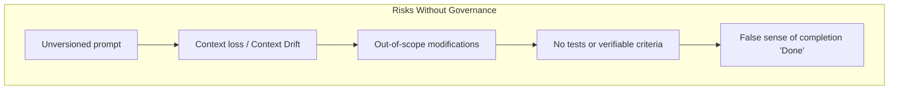
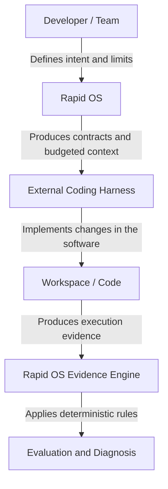

# Why Rapid OS

Software development assisted by artificial intelligence agents (AI coding harnesses) is transforming implementation speed. However, in real engineering teams, speed without control amplifies technical risk.

Rapid OS was born to bridge the gap between the **probabilistic inference of the model** and the **deterministic certainty of software engineering**.

---

## The problem: the limits of development with AI agents

When a developer interacts with a coding harness (such as Codex, Claude, Cursor, Antigravity, or VS Code Agent), recurring structural problems arise:

### 1. Context Loss & Drift
Language models have a finite, limited context window. When they are given the entire repository or unstructured instructions:
- They forget previously established architecture rules or coding standards.
- They generate code incompatible with the project's library versions.
- They hallucinate assumptions when explicit information is missing.

### 2. Ambiguous specifications vs. volatile prompts
A conversational prompt in a chat window is not an engineering specification. It has no version, it is not recorded in Git history, it does not formally define the acceptance criteria, and it does not delimit which changes are strictly **out-of-scope**.

### 3. Out-of-scope modifications (*Scope Creep*)
An agent instructed to "fix a bug in the login form" frequently refactors adjacent components, changes dependencies unnecessarily, or alters public API contracts, introducing regressions that are hard to detect.

### 4. Lack of verifiable evidence
An agent stating in its chat *"I have completed the task and all tests pass"* is not technical proof. Frequently:
- The tests were not even run.
- Critical validations were skipped.
- There is no cryptographic record of which files were read or modified, nor of the real results of the commands.

---

## The value proposition: contract-based governance

Rapid OS introduces a **deterministic governance and control layer** around the coding harness's work, without interfering with its generative capability:

| Capability | Without Rapid OS | With Rapid OS v3 |
| :--- | :--- | :--- |
| **Repository intelligence** | The agent blindly inspects random files. | `rapid scan` extracts typed facts with provenance and evidence (`ProjectModel`). |
| **Specification** | Ephemeral prompts in chats. | `rapid spec` manages immutable specifications versioned in Git. |
| **Context** | Massive dump with no token budget. | `rapid context` compiles relevant, prioritized context with a strict character limit. |
| **Execution rules** | The agent operates without explicit restrictions. | `rapid policy` and `rapid run` set the risk level, required workspace, and mandatory gates. |
| **Harness capabilities** | It is assumed the agent can do everything. | `rapid harness` checks the required permissions against the declared capabilities. |
| **Verification** | Blind trust in the LLM's response. | `rapid evidence` and `rapid eval` evaluate reproducible physical evidence using deterministic rules. |

---

## Who Rapid OS is for

Rapid OS is designed to address real needs across different roles in the organization:

- **Individual developers:** To structure complex tasks, keep the agent from breaking unrelated parts of the project, and compile the exact context for each prompt.
- **Tech leads and architects:** To preserve architectural integrity, control dependencies, and define immutably what is allowed in each iteration.
- **Engineering and DevOps teams:** To ensure that every AI-generated change has complete traceability between intent, specification, code diff, and test results.
- **QA and Compliance teams:** To audit with mathematical rigor (SHA-256) what happened during the execution of a task and to have deterministic evaluations independent of any LLM.
