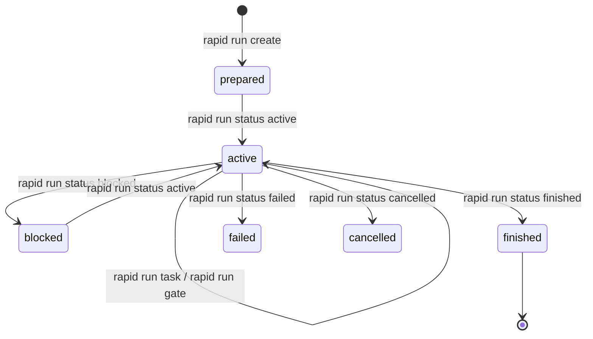

# Execution Policies and Contracts

In RAPID OS, code is not modified at random or on the agent's ungoverned initiative. Every work cycle is mediated by an **Execution Contract** (`ExecutionContract`), which is evaluated deterministically by the **Policy** engine (`ExecutionPolicyEvaluator`) against `.rapid-os/policy.json`.

---

## 1. Initializing and viewing the policy

RAPID OS ships with a default policy built into the system. You can inspect it or initialize a local file to customize it at the project level:

```bash
# Inspect the active policy (default or project)
rapid policy show

# Emit pure JSON
rapid policy show --json

# Initialize .rapid-os/policy.json in the current project
rapid policy init
```

> **Note**: If `.rapid-os/policy.json` already exists, `rapid policy init` aborts with diagnostic `RAPID1005` to prevent accidental overwrites.

---

## 2. Anatomy of `.rapid-os/policy.json`

A `.rapid-os/policy.json` file follows the canonical schema version 1:

```json
{
  "schema_version": 1,
  "minimum_classification": "spike",
  "minimum_risk": "low",
  "architectural_tags": [
    "architectural",
    "architecture",
    "auth",
    "authentication",
    "authorization",
    "ci",
    "database-migration",
    "database-schema",
    "deployment",
    "infra",
    "infrastructure",
    "migration",
    "migrations",
    "schema",
    "security"
  ],
  "architectural_path_prefixes": [
    ".github/workflows/",
    "alembic/",
    "auth/",
    "deploy/",
    "infra/",
    "migrations/",
    "prisma/",
    "security/",
    "supabase/migrations/",
    "terraform/"
  ],
  "high_risk_tags": [
    "architecture",
    "auth",
    "authentication",
    "ci",
    "database-migration",
    "database-schema",
    "deployment",
    "infra",
    "infrastructure",
    "migration",
    "migrations",
    "security"
  ],
  "critical_risk_tags": [
    "auth-migration",
    "breaking-change",
    "critical",
    "destructive-migration",
    "production-auth",
    "production-migration",
    "security-critical"
  ],
  "workspace_by_risk": {
    "low": "current_allowed",
    "medium": "current_allowed",
    "high": "isolated_required",
    "critical": "isolated_required"
  },
  "waivable_gate_ids": [
    "gate.review",
    "gate.tests"
  ],
  "extra_required_gate_ids": []
}
```

### Key components

| Field | Purpose | Allowed values |
| :--- | :--- | :--- |
| `schema_version` | Policy schema version | Positive integer (`1`) |
| `minimum_classification` | Minimum classification enforced for any run | `"spike"`, `"bounded"`, `"architectural"` |
| `minimum_risk` | Minimum risk level assigned to any run | `"low"`, `"medium"`, `"high"`, `"critical"` |
| `workspace_by_risk` | Workspace isolation requirement per risk level | Object with keys `low`, `medium`, `high`, `critical` and values `"current_allowed"` or `"isolated_required"` |
| `waivable_gate_ids` | Subset of gates that a human can explicitly waive with a justified reason | Subset of `["gate.review", "gate.tests"]` |
| `extra_required_gate_ids` | Additional gates required unconditionally | Subset of IDs from the canonical gate catalog |
| `architectural_path_prefixes` | Path prefixes that automatically raise the classification to `architectural` if modified | Relative POSIX paths |
| `high_risk_tags` / `critical_risk_tags` | Spec tags that raise the risk level to `high` or `critical` | List of identifier strings |

---

## 3. Canonical Gate Catalog (`CANONICAL_GATE_CATALOG`) {#available-gates}

In the execution contracts generated by RAPID OS, gates are identified by canonical identifiers prefixed with `gate.`:

| Canonical identifier | Underlying `GateKind` | Phase | Meaning and expected evidence |
| :--- | :--- | :--- | :--- |
| `gate.workspace-isolation` | `workspace_isolation` | `pre_execution` | Verification of execution in an isolated workspace. Requires `workspace` evidence. |
| `gate.baseline` | `baseline_check` | `pre_execution` | Health check before changes. Requires `test_result` or `command_result` evidence. |
| `gate.manual-approval` | `manual_approval` | `pre_execution` | Pre-execution approval at critical risk. Requires `review` or `delegation` evidence. |
| `gate.tests` | `implementation_tests` | `post_execution` | Unit or integration tests. Requires successful `test_result` evidence. |
| `gate.architecture` | `architecture_check` | `post_execution` | Only if the project has `.rapid-os/standards/architecture.json` and the mode is `feature`, `bugfix`, or `refactor`. Requires `command_result` evidence from `rapid arch check` with `exit_code: 0`. Not waivable. |
| `gate.review` | `peer_review` | `post_execution` | Architectural or peer review. Requires approved `review` evidence. |
| `gate.security-review` | `security_review` | `post_execution` | Security analysis or review. Requires `review` or `command_result` evidence. |
| `gate.migration-review` | `migration_review` | `post_execution` | Review of migration scripts. Requires specialized `review` evidence. |
| `gate.final-verification` | `final_verification` | `post_execution` | Contractual verification closing the cycle. Requires a full evaluation of the run. |

---

## 4. Lifecycle of a Contract and its State (`RunState`)

When you run `rapid run create --spec <spec-id> --harness <harness-id>`, RAPID OS:
1. Resolves the immutable spec and its SHA-256 digest.
2. Evaluates the paths and tags against `.rapid-os/policy.json`.
3. Emits a `PolicyDecision` with the risk and the required gates.
4. Generates the immutable contract (`contract.json`).
5. Initializes the state at revision 1 (`state_0001.json`) with status `prepared`.



### State Transitions

```bash
# 1. Start execution
rapid run status mi-run-001 active --reason "Inicio de implementación"

# 2. Update a contract task
rapid run task mi-run-001 T1 done --reason "Endpoints implementados con tests"

# 3. Acknowledge a gate with evidence
rapid run gate mi-run-001 gate.baseline acknowledged --reason "Baseline verde confirmado"

# 4. Finish the run's execution
rapid run status mi-run-001 finished --reason "Tareas concluidas y pruebas pasando"
```

---

## 5. Justified Waivers

If a gate is declared in `waivable_gate_ids` within the policy (`gate.review`, `gate.tests`), a waiver can be granted when the circumstances justify it:

```bash
rapid run gate \
  mi-run-001 \
  gate.review \
  waived \
  --reason "Exención autorizada por hotfix de emergencia en producción (incidente #992)"
```

> **Integrity rule**: If you try to waive a gate that is **not** in `waivable_gate_ids`, RAPID OS rejects the operation with diagnostic `RAPID1013`. In addition, when the run is evaluated (`rapid eval run`), the report marks the gate as waived and the verdict is `pass_with_waivers`.
