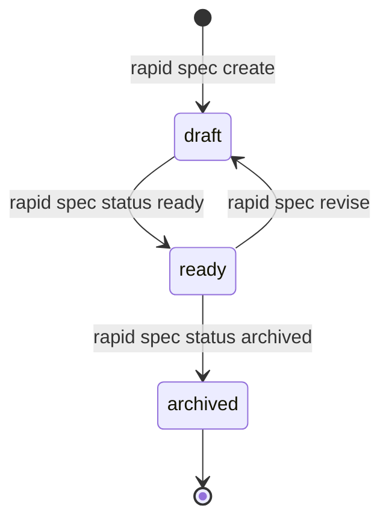

# Cómo se escribe la spec

Cada trabajo empieza con una **spec**: una ficha corta que dice qué se va a construir y cómo se sabe que está terminado. Evita que el agente improvise o se salga del alcance.

## Con shortcuts

**No la escribes tú.** Pides el trabajo y el agente la redacta:

```text
/rapid-feature añadir exportación CSV al informe mensual
```

La spec tiene cuatro partes que conviene que tu pedido deje claras:

| Parte | Ejemplo |
| :--- | :--- |
| **Objetivo**: para qué | Compartir el informe mensual fuera de la app |
| **Alcance**: qué entra y qué no | Solo el informe mensual; no el semanal |
| **Criterios de aceptación**: cómo sabes que funciona | El informe se descarga como CSV con las mismas columnas que en pantalla |
| **Tareas**: los pasos | `T001` Añadir la exportación, `T002` Añadir el botón |

Si tu pedido no alcanza para alguna parte, el agente te pregunta antes de redactarla. Un pedido con un criterio concreto ("con las mismas columnas que en pantalla") produce una spec mejor que uno genérico ("mejorar el informe").

Si ya tienes un brief del proyecto con historias (`- [ ] H001: ...`), escribe solo `/rapid-feature`: el agente te propone la siguiente historia y espera tu confirmación.

Una vez redactada, la spec queda **congelada** para ese trabajo: si cambias de idea a mitad de camino, cancela el trabajo y pide uno nuevo (ver [Cuando el agente se detiene](./when-the-agent-stops.md)).

<details>
<summary>Qué hace el agente por debajo</summary>

1. El shortcut ejecuta `rapid next --json`. Sin run activo, la acción es `author_spec` e incluye `action.spec_template`: la plantilla del modo (título, objetivo de negocio, problema, alcance, criterios de aceptación, tareas…).
2. El agente redacta la spec desde tu objetivo **siguiendo esa plantilla** y la pasa por stdin a `rapid start <modo> --spec-file -`. Los alias `acceptance` y `tasks` se aceptan en lugar de `acceptance_criteria` e `implementation_tasks`.
3. `rapid start` crea la spec, el contrato y el run, y devuelve la siguiente acción (normalmente el baseline).

```bash
echo '{"title": "Exportar informe a CSV", "business_objective": "Compartir el informe mensual", "problem_statement": "Hoy solo se puede ver en pantalla", "acceptance_criteria": ["El informe se descarga como CSV"], "tasks": ["T001: Añadir export_csv al informe"]}' | rapid start feature --spec-file - --json
```

Sin run activo, `rapid next` solo conoce la plantilla de `feature`; los demás shortcuts piden la suya con `rapid start <modo> --json`. El bucle completo está en la [guía de shortcuts](../guides/shortcuts.md#4-el-bucle-que-siguen).

</details>

## Modo avanzado

No lo necesitas con shortcuts. Es la forma de crear specs a mano con `rapid spec`, útil desde CI o para auditoría.

<details>
<summary>Ver la spec con los comandos v3</summary>

Cada spec vive en `.rapid-os/specs/<spec-id>/`. Se crea con un título y sus tareas; el id sale del título y el modo por defecto es `feature` (cámbialo con `--mode`):

```bash
rapid spec create --title "API Rate Limiting" --task "T001: Crear el middleware de rate limit"
rapid spec status api-rate-limiting ready
```

Una spec nace como `draft` y solo entra a un run cuando está `ready`. Los demás campos (objetivo, alcance, criterios de aceptación…) se añaden con una revisión, que nunca sobrescribe la anterior y vuelve a dejar la spec en `draft`:

```bash
rapid spec revise api-rate-limiting --acceptance "Responde HTTP 429 tras 5 intentos fallidos"
rapid spec status api-rate-limiting ready
```

Para consultarlas:

```bash
rapid spec list
rapid spec show api-rate-limiting
```



Todos los campos (`--objective`, `--scope`, `--out-of-scope`, `--acceptance`, `--task`…) están en la [referencia de `rapid spec`](../cli.md#spec-registry-rapid-spec).

</details>
