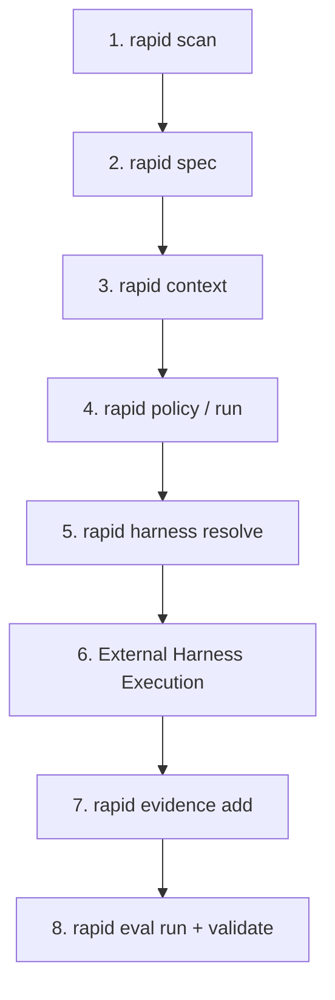

# Next steps

You already know the essentials: `/rapid-init` once per project, `/rapid-<mode>` for each job and `rapid approve` when the agent asks you to. From here, choose where to go next.

## Practice with the labs

Five small projects, one per mode, with the same four-step walkthrough. Start with [Feature](../tutorials/feature-lab.md) and continue with [Bugfix](../tutorials/bugfix-lab.md). They are all in [Labs](../tutorials/index.md).

## Pick the right mode

| If you are going to… | Use | What Rapid OS requires |
| :--- | :--- | :--- |
| Build something new | `/rapid-feature` | Passing tests and your final approval |
| Fix a bug | `/rapid-bugfix` | A test that reproduces the bug before fixing it |
| Reorganize code without changing what it does | `/rapid-refactor` | That the tests that were passing do not regress |
| Improve security | `/rapid-hardening` | Work in an isolated copy and a human review |
| Investigate or compare options | `/rapid-research` | Findings recorded; no tests required |

Each mode has its guide in [Engineering modes](../guides/modes/index.md).

## Work as a team

- **Version the shortcuts with the repository** so everyone uses the same workflow: `rapid init --shortcuts` at the project root leaves them in each agent's folder (`.claude/skills/`, `.agents/skills/`…).
- **After updating Rapid OS**, repeat the command you used to install the shortcuts (`rapid shortcuts install --global --harness <agent>`, or `rapid shortcuts install` inside the project) to refresh the ones that changed.
- **In CI**, the advanced mode commands verify the work without an agent: see [CI/CD integration](../guides/ci-cd-integration.md).

## If something fails

Rapid OS messages carry a `RAPIDxxxx` code. Look it up in the [diagnostics catalog](../troubleshooting/diagnostics.md); the most common cases with shortcuts are in [common problems](../troubleshooting/tutorials.md).

---

## Advanced mode

You do not need it to work with shortcuts. If you want to understand what Rapid OS records at each step (contracts, evidence, evaluation), this is the full cycle with the v3 commands.

See the governance cycle under the hood

## The full 8-phase cycle

---

## The advanced governance stages

### 1. Execution policies (`rapid policy`)
Sets the team's corporate and risk rules in `.rapid-os/policy.json`: which risk levels (`low`, `medium`, `high`, `critical`) require isolated workspaces and which quality gates are indispensable.

### 2. Contracts and Run lifecycle (`rapid run`)
Create a run with `rapid run create --spec <spec-id> --harness <harness-id>`. This generates an immutable `ExecutionContract` and opens the state ledger (`RunState`) to monitor task progress (`T001`...) and gate disposition (`gate.tests`...).

### 3. Capability resolution (`rapid harness`)
Use `rapid harness resolve` to check whether the selected agent's profile declares support for the operations the contract requires. If the contract requires modifying files and the harness does not declare `repository.write`, the process flags the incompatibility before starting.

### 4. Physical evidence ingestion (`rapid evidence`)
When the agent's work ends, collect the execution results (command logs, test reports, Git diffs) with `rapid evidence add`. The files are copied to `.rapid-os/evidence/<run-id>/artifacts/` with their size and immutable SHA-256 hash.

### 5. Deterministic behavioral evaluations (`rapid eval`)
Run `rapid eval run --run <run-id>`. The evaluation engine analyzes the collected physical evidence and issues a mathematical verdict (`PASS`, `PASS_WITH_WAIVERS`, `UNVERIFIED` or `FAIL`), guaranteeing that no task is considered complete without demonstrable proof.

---

## Recommended resources

To go deeper into each of these technical areas, see:

- **[Detailed v3 governance loop](../governance-loop.md):** In-depth explanation of state transitions, cross hashes and logical rules.
- **[Harness capabilities and permissions](../guides/permissions-capabilities.md):** Canonical catalog of capabilities and AI tool profiles.
- **[File structure and boundaries](../guides/project-layout.md):** Which directories Rapid OS creates and which are immutable.
- **[Full CLI reference](../cli.md):** All the commands, arguments, options and exit codes of the `rapid` executable.
- **[Rapid OS v3 architecture](../architecture/rapid-os-v3.md):** Technical specification for architects and integrators.

