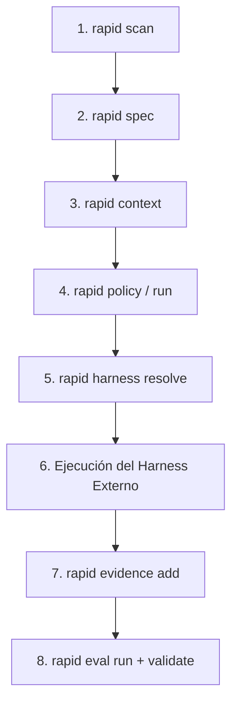

# Próximos pasos

Ya sabes lo esencial: `/rapid-init` una vez por proyecto, `/rapid-<modo>` para cada trabajo y `rapid approve` cuando el agente te lo pide. Desde aquí, elige por dónde seguir.

## Practica con los laboratorios

Cinco proyectos pequeños, uno por modo, con el mismo recorrido de cuatro pasos. Empieza por [Feature](../tutorials/feature-lab.md) y sigue con [Bugfix](../tutorials/bugfix-lab.md). Todos están en [Laboratorios](../tutorials/index.md).

## Elige el modo adecuado

| Si vas a… | Usa | Lo que exige Rapid OS |
| :--- | :--- | :--- |
| Construir algo nuevo | `/rapid-feature` | Tests que pasan y tu aprobación final |
| Corregir un bug | `/rapid-bugfix` | Un test que reproduce el bug antes de corregirlo |
| Reorganizar código sin cambiar lo que hace | `/rapid-refactor` | Que no bajen los tests que pasaban |
| Mejorar la seguridad | `/rapid-hardening` | Trabajo en una copia aislada y una revisión humana |
| Investigar o comparar opciones | `/rapid-research` | Hallazgos registrados; no exige tests |

Cada modo tiene su guía en [Modos de ingeniería](../guides/modes/index.md).

## Trabaja en equipo

- **Versiona los shortcuts con el repositorio** para que todos usen el mismo flujo: `rapid init --shortcuts` en la raíz del proyecto los deja en la carpeta de cada agente (`.claude/skills/`, `.agents/skills/`…).
- **Tras actualizar Rapid OS**, repite el comando con el que instalaste los shortcuts (`rapid shortcuts install --global --harness <agente>`, o `rapid shortcuts install` dentro del proyecto) para refrescar los que cambiaron.
- **En CI**, los comandos del modo avanzado verifican el trabajo sin agente: ver [Integración con CI/CD](../guides/ci-cd-integration.md).

## Si algo falla

Los mensajes de Rapid OS traen un código `RAPIDxxxx`. Búscalo en el [catálogo de diagnósticos](../troubleshooting/diagnostics.md); los casos más comunes con shortcuts están en [problemas frecuentes](../troubleshooting/tutorials.md).

---

## Modo avanzado

No lo necesitas para trabajar con shortcuts. Si quieres entender qué registra Rapid OS en cada paso (contratos, evidencia, evaluación), este es el ciclo completo con los comandos v3.

Ver el ciclo de gobernanza por dentro

## El ciclo completo de 8 fases

---

## Las etapas avanzadas de gobernanza

### 1. Políticas de ejecución (`rapid policy`)
Establece las reglas corporativas y de riesgo del equipo en `.rapid-os/policy.json`: qué niveles de riesgo (`low`, `medium`, `high`, `critical`) requieren espacios de trabajo aislados y qué gates de calidad son indispensables.

### 2. Contratos y ciclo de vida del Run (`rapid run`)
Crea un run con `rapid run create --spec <spec-id> --harness <harness-id>`. Esto genera un `ExecutionContract` inmutable y abre el libro contable de estados (`RunState`) para monitorear el progreso de tareas (`T001`...) y la disposición de gates (`gate.tests`...).

### 3. Resolución de capacidades (`rapid harness`)
Comprueba mediante `rapid harness resolve` si el perfil del agente seleccionado declara soporte para las operaciones requeridas por el contrato. Si el contrato requiere modificar archivos y el harness no declara `repository.write`, el proceso alerta la incompatibilidad antes de iniciar.

### 4. Ingesta de evidencia física (`rapid evidence`)
Al finalizar el trabajo del agente, recopila los resultados de ejecución (logs de comandos, reportes de pruebas, diffs de Git) con `rapid evidence add`. Los archivos se copian a `.rapid-os/evidence/<run-id>/artifacts/` con su tamaño y hash SHA-256 inmutable.

### 5. Evaluaciones deterministas de comportamiento (`rapid eval`)
Ejecuta `rapid eval run --run <run-id>`. El motor de evaluación analiza la evidencia física recopilada y emite un veredicto matemático (`PASS`, `PASS_WITH_WAIVERS`, `UNVERIFIED` o `FAIL`), garantizando que ninguna tarea se dé por completada sin prueba demostrable.

---

## Recursos recomendados

Para profundizar en cada una de estas áreas técnicas, consulta:

- **[Ciclo de gobernanza v3 detallado](../governance-loop.md):** Explicación profunda de las transiciones de estado, hashes cruzados y reglas lógicas.
- **[Capabilities y permisos del harness](../guides/permissions-capabilities.md):** Catálogo canónico de capacidades y perfiles de herramientas de IA.
- **[Estructura y límites de archivos](../guides/project-layout.md):** Qué directorios crea Rapid OS y cuáles son inmutables.
- **[Referencia completa de CLI](../cli.md):** Todos los comandos, argumentos, opciones y códigos de retorno del ejecutable `rapid`.
- **[Arquitectura de Rapid OS v3](../architecture/rapid-os-v3.md):** Especificación técnica para arquitectos e integradores.

