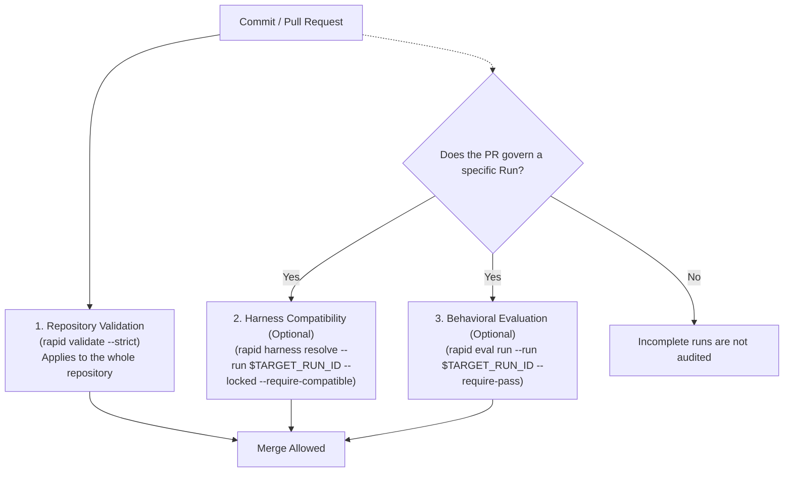

# CI/CD Integration

RAPID OS does not only govern the local work of developers and coding harnesses; its commands emit standardized exit codes and deterministic JSON documents (`--json`), which makes it easy to integrate into Continuous Integration (CI/CD) pipelines such as GitHub Actions, GitLab CI, or Bitbucket Pipelines.

---

## Independent CI Gates

In a CI pipeline you can add three independent controls depending on the phase of the work cycle:



---

## 1. Repository Integrity Validation (Base Control)

This control is **universal and safe for any repository or PR**. It does not assume that active runs or prior evidence exist; it validates that the templates, the Project Intelligence snapshot, the specifications, and the configuration have no errors:

```bash
rapid validate --strict
```

- **Exit code `0`**: The repository is 100% intact with no diagnostic errors or warnings.
- **Exit code `1`**: At least one warning or error diagnostic is present (blocks the pipeline).

---

## 2. Harness Capabilities Validation (Specific Control)

Applies when the PR is associated with a prepared run and the team uses declarative profiles with a lock file (`.rapid-os/capabilities.lock`):

```bash
# Requires: TARGET_RUN_ID identified and capabilities.lock present
rapid harness resolve --run "$TARGET_RUN_ID" --locked --require-compatible
```

- **Exit code `0`**: The harness satisfies all the mandatory capabilities required by the contract.
- **Exit code `1`**: An incompatibility is detected (`RAPID1110`).

---

## 3. Behavioral Evaluation Gate (Closing Control)

Applies **only to the specific Run that was completed in the PR**. 

> **Product Truth warning**: **Never** run `rapid eval run --require-pass` in a blind loop over all the folders inside `.rapid-os/runs/`. The runs directory may contain prepared, paused, cancelled, or historical runs that legitimately do not yet have complete evidence. The evaluation must explicitly target the `TARGET_RUN_ID` of the current change.

```bash
# Requires: TARGET_RUN_ID with finished external execution and recorded evidence
rapid eval run --run "$TARGET_RUN_ID" --require-pass
```

- **Exit code `0`**: The verdict is `PASS` or `PASS_WITH_WAIVERS`.
- **Exit code `1`**: The verdict is `UNVERIFIED` (`RAPID1225`) or `FAIL` (`RAPID1226`).

---

## Reference Example: GitHub Actions Workflow

Below is a reference workflow configured with **minimal permissions** (`contents: read`):

```yaml
name: RAPID OS Governance & Integrity Check

on:
  pull_request:
    branches: [main, develop]
  push:
    branches: [main]

permissions:
  contents: read

jobs:
  governance-validation:
    name: Repository Integrity Validation
    runs-on: ubuntu-latest

    steps:
      - name: Checkout repository
        uses: actions/checkout@v4

      - name: Set up Python
        uses: actions/setup-python@v5
        with:
          python-version: "3.12"
          cache: "pip"

      - name: Install RAPID OS
        run: |
          pip install .

      - name: Verify RAPID OS installation
        run: |
          rapid --version
          rapid doctor

      - name: Validate repository integrity (strict)
        run: |
          rapid validate --strict

      - name: Evaluate target governed run (if specified)
        if: env.TARGET_RUN_ID != ''
        env:
          TARGET_RUN_ID: ${{ vars.TARGET_RUN_ID }}
        run: |
          echo "Auditing specific run: $TARGET_RUN_ID"
          rapid eval run --run "$TARGET_RUN_ID" --require-pass
```

---

## Pre-commit Hooks Integration

You can add RAPID OS strict validation to your `.pre-commit-config.yaml` file to ensure the integrity of the configuration and specifications before committing local changes:

```yaml
repos:
  - repo: local
    hooks:
      - id: rapid-validate
        name: RAPID OS Integrity Check
        entry: rapid validate --strict
        language: system
        pass_filenames: false
```
