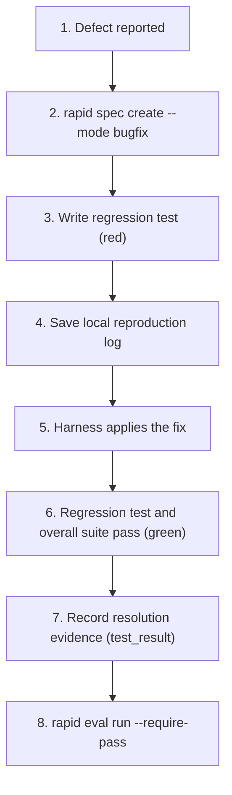

# Bugfix Mode

**Bugfix** mode prioritizes verifiable reproduction of the error, scope containment to avoid side effects, and the mandatory addition of a regression test before declaring the defect resolved.

---

## With the `/rapid-bugfix` shortcut

```text
/rapid-bugfix the 10% discount returns a negative total
```

(In Codex: `$rapid-bugfix …`.) The shortcut drives the whole run; installation and invocation per harness are in the [shortcuts guide](../shortcuts.md).

What its playbook does (`templates/modes/bugfix.json` and the Conductor rules):

- **The cause comes first (H-67).** A passing test is not a fix: a test that runs against a fake of the defective component can pass while the cause stays intact. Before writing the spec the agent locates the root cause without editing files (`git blame`, `git log -S`, a test's stack trace or reading the code) and declares it in `root_cause`: `file` (it must exist in the repository), `symbol` or `line`, `how_found` and `explanation`. Without it, or with a file that does not exist, `rapid start bugfix` refuses the spec with `RAPID1438` and says what is missing.

  ```json
  "root_cause": {
    "file": "catalog/infrastructure/sqlalchemy_catalog_reader.py",
    "symbol": "_bookable",
    "how_found": "git log -S \"is_finite\"",
    "explanation": "`or amount <= 0` was replaced by `or not amount.is_finite()`: zero and negative prices became bookable"
  }
  ```

- The template's tasks are, in order: locate and confirm the cause (before writing the test), reproduce with a red test that **runs the code of `root_cause`** (if the cause is in an adapter, infrastructure or the database, an integration test with the services up, not one with doubles of the defective component), fix the cause, and verify with the whole suite.
- The baseline is taken at `rapid start`, **before** the reproduction test exists.
- The reproduction task is the one whose description says it reproduces (`T001` in specs written before H-67). While it is in progress and there is no `reproduction.<task>` assertion in PASS, `rapid next` proposes `rapid check --expect fail --task <task>` (it runs `test_command`), which records the expected failure as evidence.
- **Closing the fix task** (the one right after the reproduction task) runs the suite on the current tree (it must pass; `--no-check` does not skip it) and then the reproduction check: Rapid OS creates a temporary git worktree with the tree of the run's baseline plus the test files the run added or changed, runs `test_command` there and requires it to fail. Dependency folders (`node_modules`, `.venv`, `venv`) are linked and `.env` is copied so the tests can run; the temporary worktree is always removed. If the tests pass on the baseline, the test does not reproduce the bug and the task stays open (`RAPID1439`); if they fail, the result is recorded as its own evidence (`command_result` with label `reproduction_holds`). If the baseline run gives no test summary to read, it is also `RAPID1439` (inconclusive), with its log. A run started without a commit has no baseline tree: the check is skipped with a warning.
- **Hand-over.** In `await_human_approval`, `rapid next` shows the declared cause, the diff lines that change its file ("fix at the cause") and, apart, the other production files the run changed ("additional defenses"), with the `reproduction_holds` evidence; `--json` puts them in `action.bugfix` (`root_cause`, `fix_at_cause`, `additional_defenses`, `reproduction_holds`, `touches_root_cause`). If the diff does not touch the `root_cause` file, it warns: `AVISO: el arreglo no toca la causa declarada`. The shortcut names the cause in the hand-over and does not hand over with that warning.
- **Architecture:** if the project has `.rapid-os/standards/architecture.json` (written by onboarding with the chosen stack), the contract includes the machine gate `gate.architecture` (mandatory, non-waivable) and `rapid next` proposes `rapid check --gate gate.architecture -- rapid arch check`. A layer or public-contract violation is `RAPID1420` and `rapid finish` does not give `PASS` until the code is fixed. Details in [Architecture by stack](../../concepts/architecture.md#the-gatearchitecture-gate).
- With the failure recorded, the reproduction task is closed with `rapid task done <task> --no-check` (the suite is red on purpose) and the fix goes in the following task.

The rest of this guide describes the same cycle with v3 commands (**Advanced mode**), useful for CI, debugging, and auditing.

---

## Bugfix mode principles

1. **No fix without a regression test**: Every defect must first be reproduced by a failing test.
2. **Minimal scope**: The patch must be strictly limited to fixing the root cause without introducing opportunistic refactors.
3. **Non-regression evidence**: Evidence must be recorded that the overall test suite still passes at 100%.

---

## Step-by-step flow



---

## 1. Register the Bugfix specification

```bash
rapid spec create \
  --title "Fix timeout en reconciliación de balance" \
  --mode bugfix \
  --objective "Corregir bloqueo por concurrencia en la consulta de saldos" \
  --scope "Servicio de reconciliación y queries SQL transaccionales" \
  --acceptance "Test de estrés concurrente pasa sin interbloqueos en <500ms" \
  --root-cause-json '{"file": "services/reconciliation/balance_query.py", "symbol": "fetch_balances", "how_found": "traza del test", "explanation": "lee los saldos sin bloqueo de filas"}' \
  --task "1. Reproducir el deadlock en test de integración" \
  --task "2. Aplicar SELECT ... FOR UPDATE SKIP LOCKED" \
  --task "3. Verificar ausencia de regresión en balance general" \
  --status ready
```

---

## 2. Compile the context focused on the defect

```bash
rapid context \
  --spec fix-timeout-en-reconciliacion-de-balance \
  --harness codex \
  --mode bugfix \
  --path "services/reconciliation" \
  --path "tests/integration/test_reconciliation.py" \
  --manifest
```

---

## 3. Create the Run and bind the policy

```bash
rapid run create \
  --spec fix-timeout-en-reconciliacion-de-balance \
  --harness codex \
  --classification bounded \
  --risk medium
```

---

## 4. Capture Reproduction and Resolution Evidence

### Step A: Initial failure evidence (local reproduction)
Capture the trace and result of the failure as a local reproduction artifact without yet recording it as a `test_result` linked to run tasks or gates (since the current evaluator would classify any `test_result` with `exit_code != 0` or `failed > 0` as an irreversible run failure):

```bash
# Run the reproduction test and store the red log as a local artifact
pytest -k test_reconciliation_deadlock > reproduction.log 2>&1 || true
```

> **Governance Note (Roadmap):** PR 2.1 will introduce formal support for contracts with `expectation: fail` for prior reproduction tests. Until then, keep the failure log as a local diagnostic artifact (`reproduction.log`) and do not link it as evidence for gates or tasks.

### Step B: Fix and non-regression evidence
Once the code change is applied and all tests pass:

```json
{
  "kind": "test_result",
  "producer": "pytest-full-suite",
  "summary": "Suite completa verde incluyendo nuevo test de regresión",
  "gate_ids": ["implementation_tests"],
  "payload": {
    "suite": "all-tests",
    "exit_code": 0,
    "passed": 48,
    "failed": 0,
    "skipped": 0
  }
}
```

```bash
rapid evidence add \
  --run fix-timeout-en-reconciliacion-de-balance-r1-run-001 \
  --input resolution-evidence.json
```

---

## 5. Final evaluation of the Run

Run the final evaluation:

```bash
rapid eval run \
  --run fix-timeout-en-reconciliacion-de-balance-r1-run-001 \
  --write \
  --require-pass
```

The verdict will confirm that the test gates (`implementation_tests`) were satisfied with empirical evidence.

