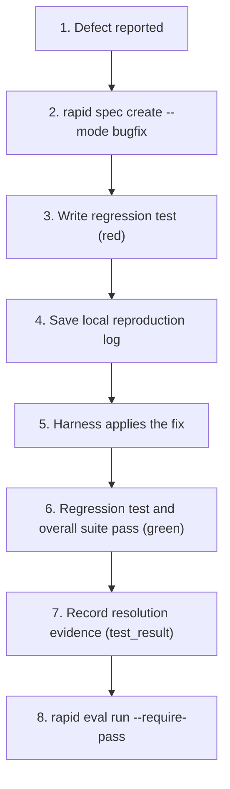

# Bugfix Mode

**Bugfix** mode prioritizes verifiable reproduction of the error, scope containment to avoid side effects, and the mandatory addition of a regression test before declaring the defect resolved.

---

## With the `/rapid-bugfix` shortcut

```text
/rapid-bugfix the 10% discount returns a negative total
```

(In Codex: `$rapid-bugfix …`.) The shortcut drives the whole run; installation and invocation per harness are in the [shortcuts guide](../shortcuts.md).

What its playbook does (`templates/modes/bugfix.json` and the Conductor rules):

- The baseline is taken at `rapid start`, **before** the reproduction test exists.
- The first task (`T001`) is "Reproduce with a red test". While it is in progress and there is no `reproduction.T001` assertion in PASS, `rapid next` proposes `rapid check --expect fail --task T001 -- <test_command>`, which records the expected failure as evidence.
- **Architecture:** if the project has `.rapid-os/standards/architecture.json` (written by onboarding with the chosen stack), the contract includes the machine gate `gate.architecture` (mandatory, non-waivable) and `rapid next` proposes `rapid check --gate gate.architecture -- rapid arch check`. A layer or public-contract violation is `RAPID1420` and `rapid finish` does not give `PASS` until the code is fixed. Details in [Architecture by stack](../../concepts/architecture.md#the-gatearchitecture-gate).
- With the failure recorded, `T001` is closed with `rapid task done T001 --no-check` (the suite is red on purpose) and the fix goes in the following tasks.

The rest of this guide describes the same cycle with v3 commands (**Advanced mode**), useful for CI, debugging, and auditing.

---

## Bugfix mode principles

1. **No fix without a regression test**: Every defect must first be reproduced by a failing test.
2. **Minimal scope**: The patch must be strictly limited to fixing the root cause without introducing opportunistic refactors.
3. **Non-regression evidence**: Evidence must be recorded that the overall test suite still passes at 100%.

---

## Step-by-step flow



---

## 1. Register the Bugfix specification

```bash
rapid spec create \
  --title "Fix timeout en reconciliación de balance" \
  --mode bugfix \
  --objective "Corregir bloqueo por concurrencia en la consulta de saldos" \
  --scope "Servicio de reconciliación y queries SQL transaccionales" \
  --acceptance "Test de estrés concurrente pasa sin interbloqueos en <500ms" \
  --task "1. Reproducir el deadlock en test de integración" \
  --task "2. Aplicar SELECT ... FOR UPDATE SKIP LOCKED" \
  --task "3. Verificar ausencia de regresión en balance general" \
  --status ready
```

---

## 2. Compile the context focused on the defect

```bash
rapid context \
  --spec fix-timeout-en-reconciliacion-de-balance \
  --harness codex \
  --mode bugfix \
  --path "services/reconciliation" \
  --path "tests/integration/test_reconciliation.py" \
  --manifest
```

---

## 3. Create the Run and bind the policy

```bash
rapid run create \
  --spec fix-timeout-en-reconciliacion-de-balance \
  --harness codex \
  --classification bounded \
  --risk medium
```

---

## 4. Capture Reproduction and Resolution Evidence

### Step A: Initial failure evidence (local reproduction)
Capture the trace and result of the failure as a local reproduction artifact without yet recording it as a `test_result` linked to run tasks or gates (since the current evaluator would classify any `test_result` with `exit_code != 0` or `failed > 0` as an irreversible run failure):

```bash
# Run the reproduction test and store the red log as a local artifact
pytest -k test_reconciliation_deadlock > reproduction.log 2>&1 || true
```

> **Governance Note (Roadmap):** PR 2.1 will introduce formal support for contracts with `expectation: fail` for prior reproduction tests. Until then, keep the failure log as a local diagnostic artifact (`reproduction.log`) and do not link it as evidence for gates or tasks.

### Step B: Fix and non-regression evidence
Once the code change is applied and all tests pass:

```json
{
  "kind": "test_result",
  "producer": "pytest-full-suite",
  "summary": "Suite completa verde incluyendo nuevo test de regresión",
  "gate_ids": ["implementation_tests"],
  "payload": {
    "suite": "all-tests",
    "exit_code": 0,
    "passed": 48,
    "failed": 0,
    "skipped": 0
  }
}
```

```bash
rapid evidence add \
  --run fix-timeout-en-reconciliacion-de-balance-r1-run-001 \
  --input resolution-evidence.json
```

---

## 5. Final evaluation of the Run

Run the final evaluation:

```bash
rapid eval run \
  --run fix-timeout-en-reconciliacion-de-balance-r1-run-001 \
  --write \
  --require-pass
```

The verdict will confirm that the test gates (`implementation_tests`) were satisfied with empirical evidence.

