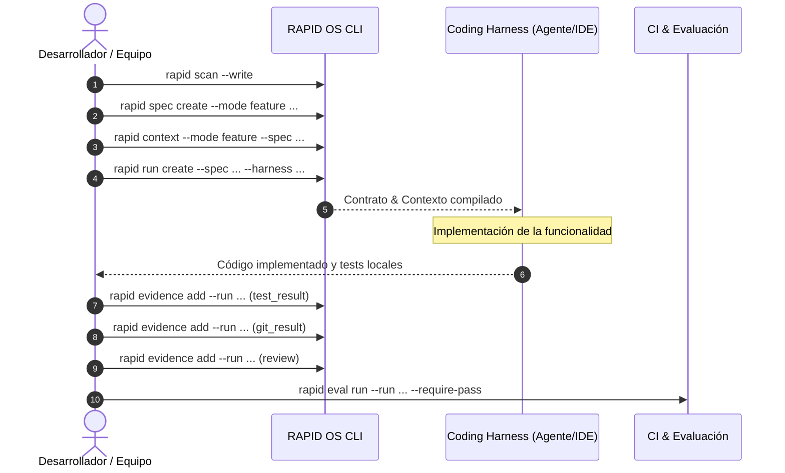

# Modo Feature

El modo **Feature** está diseñado para implementar nuevas capacidades funcionales dentro de un sistema asegurando que no se rompan contratos existentes ni se desvíe el diseño arquitectónico.

---

## Con el shortcut `/rapid-feature`

```text
/rapid-feature añadir exportación CSV al informe mensual
```

(En Codex: `$rapid-feature …`.) El shortcut conduce el run completo; la instalación y la invocación por harness están en la [guía de shortcuts](../shortcuts.md).

Qué hace su playbook (`templates/modes/feature.json` y las reglas del Conductor):

- `rapid next` entrega la plantilla de spec (`action.spec_template`: título, objetivo de negocio, alcance, criterios de aceptación y tareas atómicas `T001…`) y el agente la rellena desde tu objetivo.
- Riesgo medio por defecto: la baseline se verifica y registra al iniciar (`gate.baseline`), las tareas se verifican con `rapid check`, y quedan `gate.tests` y `gate.final-verification` (humano).
- **Arquitectura:** si el proyecto tiene `.rapid-os/standards/architecture.json` (lo escribe el onboarding con el stack elegido), el contrato incluye el gate de máquina `gate.architecture` (obligatorio, no dispensable) y `rapid next` propone `rapid check --gate gate.architecture -- rapid arch check`. Una violación de capas o de contrato público es `RAPID1420` y `rapid finish` no da `PASS` hasta que se corrija el código. Detalle en [Arquitectura por stack](../../concepts/architecture.md#el-gate-gatearchitecture).
- El bucle es implementar cada tarea → `rapid check -- <test_command>` → `rapid finish`; la aprobación final la das tú en tu terminal.

### En un proyecto nuevo (sin código ni tests)

Rapid OS observa los cambios de un run con git, así que el proyecto tiene que estar en un repositorio: el onboarding lo crea si falta (`rapid start` sin repositorio falla con `RAPID1416`). Si el repositorio no tiene código fuente (fuera de `docs/` y las carpetas ocultas) ni tests, no hay nada de lo que tomar una baseline: el comando de tests saldría en rojo antes de empezar. En ese caso `rapid start feature`:

- añade como primera tarea `T001: Scaffold mínimo con un test que pase`; tus tareas pasan a `T002…`, en el texto y en el contrato, y `rapid start` lo avisa en `notes` (por ejemplo `T001→T002`), que el agente te explica; usa siempre los ids que da `rapid next`;
- crea el contrato **sin `gate.baseline`** y con el campo opcional `baseline_waived: "empty_repository"`; el run arranca activo;
- cierra la tarea del scaffold con un `rapid check` en verde; a partir de ahí los tests son los de tu proyecto.

`rapid status` y `rapid finish` muestran `Sin baseline: proyecto nuevo`. Un repositorio con código pero sin tests conserva la baseline: crea un test que pase en una tarea, o usa el modo `research`. Los modos `bugfix`, `refactor` y `hardening` no arrancan en un repositorio vacío (`RAPID1413`: no hay código que arreglar, refactorizar o endurecer; usa `/rapid-feature`).

### La primera funcionalidad sale del brief

Si hiciste el onboarding con `/rapid-init` (o `rapid setup`), el brief (`docs/PRODUCT_BRIEF.md`) tiene una sección de historias con el formato `- [ ] H001: ...`. Cuando no hay un run activo, `rapid next` añade a la acción `author_spec` el campo opcional `seed` con **todas** las historias sin marcar, en orden, y los documentos de negocio y de modelo de datos si existen (referencia: [`rapid next`](../../cli.md#rapid-next)).

```text
/rapid-feature              # sin argumentos: propone la historia que conviene empezar y espera tu confirmación
/rapid-feature H002         # con un id: usa esa historia
```

- Sin argumentos, el agente propone una historia entre las que quedan y, si no es la primera, te explica en una frase por qué (por ejemplo, por dependencias). Redacta la spec solo después de que lo confirmes.
- Copia a `business_rules` de la spec las reglas relevantes de `docs/BUSINESS_RULES.md`, citando el documento, y etiqueta la spec con `story:<id>`.
- Si el brief sigue siendo un borrador sin confirmar (`seed.confirmed` es `false`), el agente te avisa de que parte de supuestos.
- Si la spec viene de una historia del brief, el agente añade el tag `story:<ID>` (por ejemplo `story:H002`). Cuando `rapid finish` termina en PASS, marca esa historia por ti (`H002 marcada como hecha en docs/PRODUCT_BRIEF.md`): cambia solo la línea `- [ ] H002:` a `- [x] H002:`, deja copia en `.rapid-os/backups/` y no cambia `source` ni `status` del brief. Con otro veredicto dice `H002 se marcará cuando el run pase`; con `rapid finish --no-tick` solo sugiere `Marca H002 como hecha`. Un run cubre una historia.

El resto de esta guía describe el mismo ciclo con comandos v3 (**Modo avanzado**), útil para CI, depuración y auditoría.

---

## Flujo paso a paso



---

## 1. Inspeccionar el proyecto y registrar la especificación

Antes de que el agente escriba código, captura el estado actual y formaliza la spec:

```bash
# 1. Actualizar Project Intelligence
rapid scan --write

# 2. Registrar la especificación en estado 'ready'
rapid spec create \
  --title "Notificaciones por Webhook" \
  --mode feature \
  --objective "Emitir eventos de pago completado vía webhooks HTTP" \
  --scope "Servicio de eventos y cliente HTTP con retries" \
  --acceptance "Webhook firmado con HMAC-SHA256 y tests de entrega exitosos" \
  --task "1. Crear modelo de webhook" \
  --task "2. Implementar dispatcher asíncrono con exponential backoff" \
  --task "3. Añadir suite de tests unitarios y de integración" \
  --status ready
```

---

## 2. Compilar el contexto para el Coding Harness

Compila el paquete de contexto acotado al presupuesto de tokens, asociando la spec y el perfil de harness:

```bash
rapid context \
  --spec notificaciones-por-webhook \
  --harness codex \
  --mode feature \
  --manifest
```

Revisa el manifest para confirmar qué archivos de estándares (`architecture.md`, `standards/python.md`) y del proyecto fueron incluidos o excluidos por presupuesto.

---

## 3. Crear el contrato de ejecución (`ExecutionContract`)

Genera el run formal en `.rapid-os/runs/`:

```bash
rapid run create \
  --spec notificaciones-por-webhook \
  --harness codex \
  --classification bounded \
  --risk medium
```

Esto evaluará la política (`.rapid-os/policy.json`) y definirá las compuertas necesarias (ej. `baseline_check`, `implementation_tests`, `peer_review`).

Verifica la compatibilidad del harness:

```bash
rapid harness resolve --run notificaciones-por-webhook-r1-run-001 --require-compatible
```

---

## 4. Ejecución asistida por el Harness

Entrega el contexto compilado y el objetivo a tu coding harness (Cursor, Claude Code, Copilot, Codex o Antigravity).

Durante la ejecución:
- El harness debe implementar el modelo, el dispatcher y las pruebas.
- No debe modificar archivos fuera del alcance (`--scope`) definido en la spec.

---

## 5. Ingesta de Evidencias

Una vez finalizada la implementación y ejecutadas las pruebas por las herramientas del entorno, registra la evidencia verificable:

### Evidencia de pruebas ejecutadas (`test_result`)
Crea un archivo de autoría de evidencia (por ejemplo `test-evidence.json`):

```json
{
  "kind": "test_result",
  "producer": "pytest",
  "summary": "12 tests unitarios y de integración aprobados",
  "gate_ids": ["implementation_tests"],
  "payload": {
    "suite": "feature-tests",
    "exit_code": 0,
    "passed": 12,
    "failed": 0,
    "skipped": 0
  }
}
```

Regístralo en el run:

```bash
rapid evidence add \
  --run notificaciones-por-webhook-r1-run-001 \
  --input test-evidence.json
```

### Evidencia de operaciones en git (`git_result`)
Registra la evidencia de la inspección o modificación en git:

```json
{
  "kind": "git_result",
  "producer": "git-cli",
  "summary": "Modificación y adición de archivos verificada en git",
  "payload": {
    "operation": "modify"
  }
}
```

```bash
rapid evidence add \
  --run notificaciones-por-webhook-r1-run-001 \
  --input git-evidence.json
```

---

## 6. Verificación y Evaluación Final

1. Verifica la integridad matemática de la secuencia de evidencias:
   ```bash
   rapid evidence verify --run notificaciones-por-webhook-r1-run-001
   ```

2. Ejecuta la evaluación determinista contra las reglas de comportamiento:
   ```bash
   rapid eval run \
     --run notificaciones-por-webhook-r1-run-001 \
     --write \
     --require-pass
   ```

Si todas las compuertas y reglas se satisfacen, el veredicto será `PASS` y el reporte se archivará de forma inmutable en `.rapid-os/evals/`.
