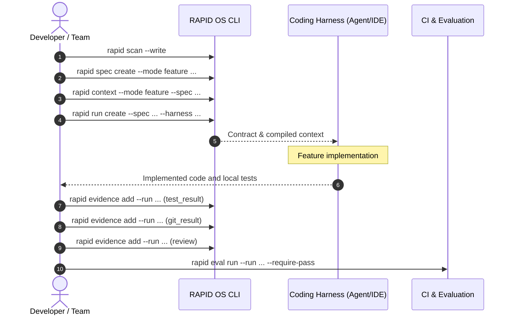

# Feature Mode

**Feature** mode is designed to implement new functional capabilities within a system while ensuring that existing contracts are not broken and the architectural design does not drift.

---

## With the `/rapid-feature` shortcut

```text
/rapid-feature add CSV export to the monthly report
```

(In Codex: `$rapid-feature …`.) The shortcut drives the whole run; installation and per-harness invocation are covered in the [shortcuts guide](../shortcuts.md).

What its playbook does (`templates/modes/feature.json` and the Conductor rules):

- `rapid next` delivers the spec template (`action.spec_template`: title, business objective, scope, acceptance criteria, and atomic tasks `T001…`) and the agent fills it in from your goal.
- Medium risk by default: the baseline is verified and recorded at start (`gate.baseline`), tasks are verified with `rapid check`, and `gate.tests` and `gate.final-verification` (human) remain.
- **Architecture:** if the project has `.rapid-os/standards/architecture.json` (written by onboarding with the chosen stack), the contract includes the machine gate `gate.architecture` (mandatory, cannot be waived) and `rapid next` proposes `rapid check --gate gate.architecture -- rapid arch check`. A layer or public-contract violation is `RAPID1420` and `rapid finish` does not give `PASS` until the code is fixed. Details in [Architecture by stack](../../concepts/architecture.md#the-gatearchitecture-gate).
- The loop is implement each task → `rapid check -- <test_command>` → `rapid finish`; you give the final approval in your terminal.

### In a new project (no code or tests)

Rapid OS observes a run's changes with git, so the project must be in a repository: onboarding creates it if missing (`rapid start` without a repository fails with `RAPID1416`). If the repository has no source code (outside `docs/` and hidden folders) and no tests, there is nothing to take a baseline from: the test command would be red before starting. In that case `rapid start feature`:

- adds `T001: Minimal scaffold with a passing test` as the first task; your tasks become `T002…`, in the text and in the contract, and `rapid start` reports it in `notes` (for example `T001→T002`), which the agent explains to you; always use the ids that `rapid next` gives;
- creates the contract **without `gate.baseline`** and with the optional field `baseline_waived: "empty_repository"`; the run starts active;
- closes the scaffold task with a green `rapid check`; from then on the tests are your project's own.

`rapid status` and `rapid finish` show `No baseline: new project`. A repository with code but no tests keeps the baseline: create a passing test in a task, or use `research` mode. The `bugfix`, `refactor`, and `hardening` modes do not start in an empty repository (`RAPID1413`: there is no code to fix, refactor, or harden; use `/rapid-feature`).

### The first feature comes from the brief

If you onboarded with `/rapid-init` (or `rapid setup`), the brief (`docs/PRODUCT_BRIEF.md`) has a stories section using the format `- [ ] H001: ...`. When there is no active run, `rapid next` adds the optional `seed` field to the `author_spec` action, containing **all** unchecked stories in order, plus the business and data-model documents if they exist (reference: [`rapid next`](../../cli.md#rapid-next)).

```text
/rapid-feature              # no arguments: proposes the story worth starting and waits for your confirmation
/rapid-feature H002         # with an id: uses that story
```

- With no arguments, the agent proposes one of the remaining stories and, if it is not the first, explains in one sentence why (for example, because of dependencies). It writes the spec only after you confirm.
- It copies the relevant rules from `docs/BUSINESS_RULES.md` into the spec's `business_rules`, citing the document, and tags the spec with `story:<id>`.
- If the brief is still an unconfirmed draft (`seed.confirmed` is `false`), the agent warns you that part of it rests on assumptions.
- If the spec comes from a brief story, the agent adds the tag `story:<ID>` (for example `story:H002`). When `rapid finish` ends in PASS, it ticks that story for you (`H002 marcada como hecha en docs/PRODUCT_BRIEF.md`): it changes only the line `- [ ] H002:` to `- [x] H002:`, leaves a copy in `.rapid-os/backups/`, and does not change the brief's `source` or `status`. With any other verdict it says `H002 se marcará cuando el run pase`; with `rapid finish --no-tick` it only suggests `Marca H002 como hecha`. One run covers one story.

The rest of this guide describes the same cycle with v3 commands (**Advanced mode**), useful for CI, debugging, and auditing.

---

## Step-by-step workflow



---

## 1. Inspect the project and record the specification

Before the agent writes code, capture the current state and formalize the spec:

```bash
# 1. Update Project Intelligence
rapid scan --write

# 2. Record the specification in 'ready' status
rapid spec create \
  --title "Webhook Notifications" \
  --mode feature \
  --objective "Emit payment-completed events via HTTP webhooks" \
  --scope "Event service and HTTP client with retries" \
  --acceptance "Webhook signed with HMAC-SHA256 and successful delivery tests" \
  --task "1. Create webhook model" \
  --task "2. Implement async dispatcher with exponential backoff" \
  --task "3. Add unit and integration test suite" \
  --status ready
```

---

## 2. Compile the context for the Coding Harness

Compile the context package bounded by the token budget, associating the spec and the harness profile:

```bash
rapid context \
  --spec notificaciones-por-webhook \
  --harness codex \
  --mode feature \
  --manifest
```

Review the manifest to confirm which standards files (`architecture.md`, `standards/python.md`) and project files were included or excluded by budget.

---

## 3. Create the execution contract (`ExecutionContract`)

Generate the formal run in `.rapid-os/runs/`:

```bash
rapid run create \
  --spec notificaciones-por-webhook \
  --harness codex \
  --classification bounded \
  --risk medium
```

This evaluates the policy (`.rapid-os/policy.json`) and defines the required gates (e.g. `baseline_check`, `implementation_tests`, `peer_review`).

Verify harness compatibility:

```bash
rapid harness resolve --run notificaciones-por-webhook-r1-run-001 --require-compatible
```

---

## 4. Harness-assisted execution

Hand the compiled context and the goal to your coding harness (Cursor, Claude Code, Copilot, Codex, or Antigravity).

During execution:
- The harness must implement the model, the dispatcher, and the tests.
- It must not modify files outside the scope (`--scope`) defined in the spec.

---

## 5. Evidence Ingestion

Once the implementation is finished and the tests have been run by the environment's tools, record the verifiable evidence:

### Test execution evidence (`test_result`)
Create an evidence authoring file (for example `test-evidence.json`):

```json
{
  "kind": "test_result",
  "producer": "pytest",
  "summary": "12 unit and integration tests passed",
  "gate_ids": ["implementation_tests"],
  "payload": {
    "suite": "feature-tests",
    "exit_code": 0,
    "passed": 12,
    "failed": 0,
    "skipped": 0
  }
}
```

Record it in the run:

```bash
rapid evidence add \
  --run notificaciones-por-webhook-r1-run-001 \
  --input test-evidence.json
```

### Git operations evidence (`git_result`)
Record the evidence of the git inspection or modification:

```json
{
  "kind": "git_result",
  "producer": "git-cli",
  "summary": "File modification and addition verified in git",
  "payload": {
    "operation": "modify"
  }
}
```

```bash
rapid evidence add \
  --run notificaciones-por-webhook-r1-run-001 \
  --input git-evidence.json
```

---

## 6. Final Verification and Evaluation

1. Verify the mathematical integrity of the evidence sequence:
   ```bash
   rapid evidence verify --run notificaciones-por-webhook-r1-run-001
   ```

2. Run the deterministic evaluation against the behavior rules:
   ```bash
   rapid eval run \
     --run notificaciones-por-webhook-r1-run-001 \
     --write \
     --require-pass
   ```

If all gates and rules are satisfied, the verdict will be `PASS` and the report will be archived immutably in `.rapid-os/evals/`.
