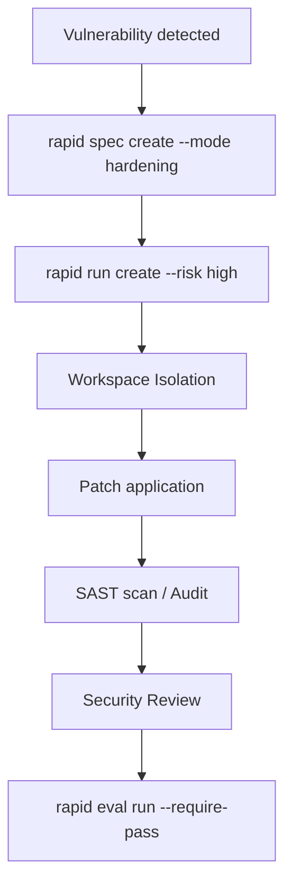

# Hardening Mode

**Hardening** mode governs high-sensitivity interventions: patching vulnerabilities (CVEs), upgrading critical dependencies, strengthening authentication/cryptography policies, and security audits of code infrastructure.

---

## With the `/rapid-hardening` shortcut

```text
/rapid-hardening validate and bound the inputs of register_user
```

(In Codex: `$rapid-hardening …`.) The shortcut drives the whole run; installation and per-harness invocation are in the [shortcuts guide](../shortcuts.md).

What its playbook does (`templates/modes/hardening.json` and the Conductor's rules):

- `high` risk: the contract requires an isolated workspace and the `gate.review` gate (waivable) in addition to the baseline, the tests, and the final verification.
- Each finding is reported with its **CWE** and its **CVSS v4.0** vector (`CVSS:4.0/...`), the resulting severity, and the rule in `.rapid-os/standards/security.md` that covers it (the "Findings: CWE and CVSS" section of the security baseline). Critical and high are fixed before publishing. See [Security baseline](../../concepts/security-baseline.md).
- `rapid start hardening --spec-file - --worktree` creates a git worktree at `../<repo>-<run-id>` (branch `rapid/<run-id>`); the ledger stays in the main repository, `rapid check` runs in the worktree, and `rapid finish` takes the changes from there. Without the flag, `rapid next` proposes `rapid start --resume --worktree`.
- The worktree starts from `HEAD` (uncommitted changes in the main checkout do not come along) and `rapid abort` does not remove it.

### Close and integrate the worktree

At `await_human_approval`, the agent should show the actual worktree path and branch `rapid/<run-id>` and explain that merging requires a commit on that run branch. Do not merge while approval, tasks, or verification are pending. After a `PASS`, `rapid finish` prints the exact manual closure commands only when the worktree is dirty. With `--merge`, it lists the short-format Git status and warns about likely build/cache artifacts before asking for written confirmation; after confirmation it commits and merges, then reports the commit and leaves removal to you:

```bash
git -C <worktree> add -A
git -C <worktree> commit -m "<spec title>"
git -C <project> merge rapid/<run-id>
git worktree remove <worktree>
```

Never use `git worktree remove` with the **--force** option while the worktree has uncommitted changes; it deletes the changes. On Windows, if checkout reports `Filename too long`, run `git config core.longpaths true` in the repository and retry.

The rest of this guide describes the same cycle with v3 commands (**Advanced mode**), useful for CI, debugging, and auditing.

---

## Characteristics of Hardening mode in RAPID OS

- **Elevated risk**: Typically evaluated as `high` (80) or `critical` (100).
- **Workspace Isolation**: The policy may require an isolated environment or branch/worktree (`isolated_required`).
- **Mandatory gates**:
  - `security_review`: Formal security approval.
  - `peer_review`: Human peer review.
  - `final_verification`: Static audit or vulnerability scan with no critical findings.



---

## 1. Hardening specification

```bash
rapid spec create \
  --title "CVE mitigation in XML parser and input sanitization" \
  --mode hardening \
  --objective "Upgrade XML parser vulnerable to XXE and restrict arbitrary deserialization" \
  --scope "parsers/xml module and pyproject.toml dependencies" \
  --acceptance "Defensive libraries upgraded, zero alerts in SAST scan, and injection tests blocked" \
  --task "1. Upgrade defensive library" \
  --task "2. Configure defusedxml disabling external entities" \
  --task "3. Add simulated XXE attack tests" \
  --status ready
```

---

## 2. Compile the security context

```bash
rapid context \
  --spec cve-mitigation-in-xml-parser-and-input-sanitization \
  --harness claude \
  --mode hardening \
  --constraint "Use of parsers without strict validation is forbidden" \
  --manifest
```

---

## 3. Create the high-risk run

```bash
rapid run create \
  --spec cve-mitigation-in-xml-parser-and-input-sanitization \
  --harness claude \
  --classification architectural \
  --risk high
```

By assigning `high` risk, the execution contract (`ExecutionContract`) will activate the `security_review` and `workspace_isolation` gates.

---

## 4. Ingesting security evidence

### Static scan / SAST evidence (`command_result`)
```json
{
  "kind": "command_result",
  "producer": "bandit-scanner",
  "summary": "Bandit security audit with no medium or high severity findings",
  "capability_ids": ["shell.execute"],
  "payload": {
    "label": "bandit -r src/xml_parser",
    "exit_code": 0
  }
}
```

```bash
rapid evidence add \
  --run cve-mitigation-in-xml-parser-and-input-sanitization-r1-run-001 \
  --input sast-evidence.json
```

### Human security review evidence (`review`)
```json
{
  "kind": "review",
  "producer": "appsec-portal",
  "summary": "Formal approval from the Application Security team",
  "gate_ids": ["security_review"],
  "payload": {
    "review_type": "security",
    "outcome": "approved",
    "reviewer": "appsec-team"
  }
}
```

```bash
rapid evidence add \
  --run cve-mitigation-in-xml-parser-and-input-sanitization-r1-run-001 \
  --input review-evidence.json
```

Acknowledge the gate in the run state:

```bash
rapid run gate \
  cve-mitigation-in-xml-parser-and-input-sanitization-r1-run-001 \
  security_review \
  acknowledged \
  --reason "Review approved by the security team"
```

---

## 5. Compliance evaluation

```bash
rapid eval run \
  --run cve-mitigation-in-xml-parser-and-input-sanitization-r1-run-001 \
  --write \
  --require-pass
```

The final verdict will certify that the security requirements and the linked evidence satisfy the execution policy before any deployment.
