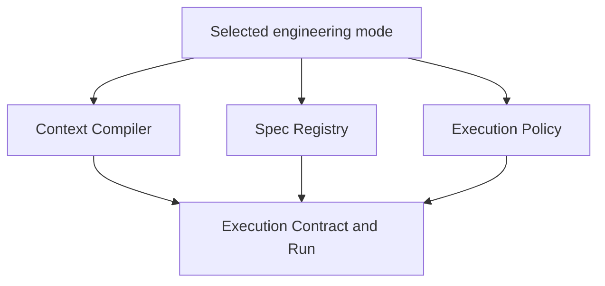

# Engineering Modes

Rapid OS classifies engineering work into **declarative modes**. Each mode defines the intent of the workflow and adjusts:

1. **Context Compiler:** Which standards, architecture rules, and constraints are included or prioritized in the generated context bundle (`rapid context --mode <mode>`).
2. **Spec Registry:** The nature of the requirements and acceptance criteria in the specification (`rapid spec create --mode <mode>`).
3. **Execution Policy:** Risk evaluation (`RiskLevel`), execution classes (`ExecutionClass`), and quality gates (`GateKind`) required before a run can finish.



## Every mode has a shortcut

The main workflow is the mode shortcut: install shortcuts once (`rapid init --shortcuts` or `rapid shortcuts install`), then the agent guides the run. The v3 commands below are **Advanced Mode**, useful for CI, debugging, and auditing.

| Mode | Shortcut (Codex uses `$` instead of `/`) | Playbook behavior |
|---|---|---|
| `feature` | `/rapid-feature <goal>` | Spec template, verified baseline at start, and `next` → `check` → `finish` loop. |
| `bugfix` | `/rapid-bugfix <bug>` | Baseline before the failing test; `rapid check --expect fail` on `T001` records reproduction. |
| `refactor` | `/rapid-refactor <scope>` | Required baseline; blocks if the passing test count drops below it. |
| `hardening` | `/rapid-hardening <area>` | Isolated worktree with `rapid start --worktree`; `gate.review` can be waived. |
| `research` | `/rapid-research <topic>` | Spike with no required tests; attach findings with `rapid attach`. |

There are also `/rapid-next`, `/rapid-status`, and `/rapid-approve` (the last one does not approve; it gives you the command to run in your terminal). See the [shortcuts guide](../shortcuts.md).

## Available modes

Rapid OS supports these five canonical operating modes:

| Mode | Main intent | Context focus | Typical risk | Suggested gates |
|---|---|---|---|---|
| [Feature](./feature.md) | New feature or capability | Functional requirements, API contracts, design standards | `medium` (50) to `high` (80) | Baseline, unit/integration tests, peer review |
| [Bugfix](./bugfix.md) | Fix defects or regressions | Reproduction case, affected code, existing tests | `low` (10) to `medium` (50) | Baseline, regression test, review |
| [Refactor](./refactor.md) | Improve structure without changing behavior | Architecture, interface contracts, full test suite | `medium` (50) to `high` (80) | Strict baseline, unchanged API, peer review |
| [Hardening](./hardening.md) | Security, robustness, observability, dependencies | Vulnerabilities, security policies, dependencies | `high` (80) to `critical` (100) | Security review, static audit, isolated verification |
| [Research](./research.md) | Exploratory spikes and feasibility prototypes | Open context, technical documentation, proofs of concept | `low` (10), `ExecutionClass.SPIKE` | Minimal or waivable gates; no critical code changes |

## How the mode affects Rapid OS commands

### 1. Context compilation (`rapid context`)

With `rapid context --mode <mode>`, the compiler selects the most relevant standards:

```bash
# Compile context for a new feature
rapid context --mode feature --objective "Add OAuth2 authentication" --manifest

# Compile context for security hardening
rapid context --mode hardening --objective "Rotate secrets and sanitize inputs" --manifest
```

### 2. Specification creation (`rapid spec create`)

The formal spec records the mode to maintain traceability between design and execution:

```bash
rapid spec create \
  --title "Migrate checkout endpoint to v2" \
  --mode refactor \
  --objective "Restructure handlers to decouple persistence" \
  --scope "Payment service and HTTP controllers" \
  --acceptance "All tests pass without changing external contracts" \
  --status ready
```

### 3. Run creation (`rapid run create`)

When creating a run from a spec, execution policy evaluates the mode along with tags and affected paths to calculate the execution class:

```bash
rapid run create --spec checkout-v2 --harness codex
```

## Next step

Start with the [shortcuts guide](../shortcuts.md), then explore the detailed guide for each mode:

- [Feature mode](./feature.md)
- [Bugfix mode](./bugfix.md)
- [Refactor mode](./refactor.md)
- [Hardening mode](./hardening.md)
- [Research mode](./research.md)
