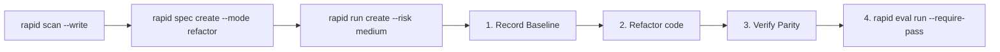

# Refactor Mode

**Refactor** mode governs changes to the internal structure of the code (simplification, decoupling, performance, technical-debt removal) while guaranteeing that external contracts and observable behavior remain identical.

---

## With the `/rapid-refactor` shortcut

```text
/rapid-refactor separate the commission calculation from the output format
```

(In Codex: `$rapid-refactor …`.) The shortcut drives the whole run; installation and per-harness invocation are covered in the [shortcuts guide](../shortcuts.md).

What its playbook does (`templates/modes/refactor.json` and the Conductor rules):

- The baseline is mandatory (`gate.baseline`): it is the non-regression reference.
- **Architecture:** if the project has `.rapid-os/standards/architecture.json` (written by onboarding with the chosen stack), the contract includes the machine gate `gate.architecture` (mandatory, cannot be waived) and `rapid next` proposes `rapid check --gate gate.architecture -- rapid arch check --new-only`. A layer or public-contract violation is `RAPID1420` and `rapid finish` does not give `PASS` until the code is fixed. Only violations the run adds count: the ones the project already had when the run started are debt, reported but not blocking, and **a refactor is where that debt is paid**: in this mode a file the run touches that still has an old violation counts as failing, so a file cannot be touched and left violating. When `api/` (or the stack's entry layer) imports `infrastructure/`, the message says where the composition goes for the stack (for `python-fastapi`, `app/main.py` or the module's `public.py`). Details in [Architecture by stack](../../concepts/architecture.md#the-gatearchitecture-gate).
- When all tasks finish, if the last `test_result` has fewer passing tests than the baseline, `rapid next` returns `blocked` with the difference: a refactor cannot reduce the number of passing tests. The comparison is never skipped silently: from the moment the run is active, a refactor whose `gate.baseline` has no test run **with a count** (the baseline was recorded as a plain command, or the output had no summary Rapid OS can read) is `blocked` with the instruction to repeat it (`rapid check --gate gate.baseline -- <test command>`), and the lost-coverage check also applies mid-run. A check bound to the baseline or to a task counts as a test run when its output has a summary, whatever its argv. If the baseline and the latest test run used different commands, `rapid next` and `rapid finish` warn that their counts are not comparable. Before approval, `rapid approve` and `rapid finish`, the code must be the one the last `gate.tests` check saw (`RAPID1423`), so a test cannot be deleted after the last check.
- This is a Conductor rule (`rapid_os/orchestration/conductor.py`), not an evaluator rule.

The rest of this guide describes the same cycle with v3 commands (**Advanced mode**), useful for CI, debugging, and auditing.

---

## Golden rules of Refactor in RAPID OS

1. **Behavior invariance**: If the existing functional tests need assertion changes to pass, it is not a pure refactor; it is a functional change in disguise.
2. **Mandatory baseline**: A verified snapshot of the test state must exist before the first line of code is modified.
3. **Suite parity**: The same test suite must run before and after with 0 failures.

---

## Step-by-step workflow



---

## 1. Refactor Specification

Record the exact boundaries of the restructuring:

```bash
rapid spec create \
  --title "Decouple persistence layer in payments" \
  --mode refactor \
  --objective "Extract an abstract repository to isolate the database from the domain logic" \
  --scope "payments/ module and adapters/db/" \
  --acceptance "0 changes to public service signatures and a 150-test suite passing at 100%" \
  --task "1. Define PaymentRepositoryProtocol" \
  --task "2. Implement PostgresPaymentRepository" \
  --task "3. Inject dependency into PaymentService" \
  --status ready
```

---

## 2. Start the Run and record the Baseline

Create the run in RAPID OS:

```bash
rapid run create \
  --spec desacoplar-capa-de-persistencia-en-pagos \
  --harness codex \
  --classification bounded \
  --risk medium
```

### Baseline Evidence Capture
Run the full suite on the original code and add the evidence:

```json
{
  "kind": "test_result",
  "producer": "pytest-baseline",
  "summary": "Baseline of 150 passing tests on the original code",
  "gate_ids": ["baseline_check"],
  "payload": {
    "suite": "all-tests-baseline",
    "exit_code": 0,
    "passed": 150,
    "failed": 0,
    "skipped": 0
  }
}
```

```bash
rapid evidence add \
  --run desacoplar-capa-de-persistencia-en-pagos-r1-run-001 \
  --input baseline-evidence.json
```

Acknowledge the baseline gate in the run state:

```bash
rapid run gate \
  desacoplar-capa-de-persistencia-en-pagos-r1-run-001 \
  baseline_check \
  acknowledged \
  --reason "Baseline executed and verified with 150 green tests"
```

---

## 3. Executing the Refactor in the Harness

Hand the instructions to your agent or code assistant, making sure it does not touch the existing contract test files.

---

## 4. Post-change Evidence and Diff Capture

### Test parity evidence
```json
{
  "kind": "test_result",
  "producer": "pytest-post-refactor",
  "summary": "150 tests passed after the refactor with zero failures",
  "gate_ids": ["implementation_tests"],
  "payload": {
    "suite": "all-tests-post-refactor",
    "exit_code": 0,
    "passed": 150,
    "failed": 0,
    "skipped": 0
  }
}
```

```bash
rapid evidence add \
  --run desacoplar-capa-de-persistencia-en-pagos-r1-run-001 \
  --input post-evidence.json
```

### File change evidence (`file_change`)
```json
{
  "kind": "file_change",
  "producer": "git-inspector",
  "summary": "Restructuring confined to the payments module without touching tests",
  "payload": {
    "paths": [
      "payments/service.py",
      "payments/repositories.py"
    ]
  }
}
```

```bash
rapid evidence add \
  --run desacoplar-capa-de-persistencia-en-pagos-r1-run-001 \
  --input files-evidence.json
```

---

## 5. Behavior Evaluation

```bash
rapid eval run \
  --run desacoplar-capa-de-persistencia-en-pagos-r1-run-001 \
  --write \
  --require-pass
```

The evaluation engine will confirm that the baseline gate and the implementation tests are verified with suitable mathematical evidence.

