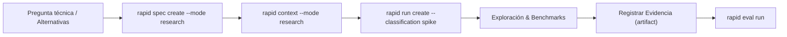

# Modo Research

El modo **Research** está orientado a spikes técnicos, evaluación de bibliotecas, pruebas de concepto (PoC) y benchmarks donde el objetivo no es entregar código productivo inmediato, sino responder una duda de diseño o viabilidad.

---

## Con el shortcut `/rapid-research`

```text
/rapid-research comparar JSON y SQLite para guardar las preferencias
```

(En Codex: `$rapid-research …`.) El shortcut conduce el run completo; la instalación y la invocación por harness están en la [guía de shortcuts](../shortcuts.md).

Qué hace su playbook (`templates/modes/research.json` y las reglas del Conductor):

- Un spike es de riesgo bajo: solo queda `gate.final-verification`; no hay baseline ni tests obligatorios.
- Los hallazgos se registran con `rapid attach <ruta> --label "…"` (evidencia `artifact`, productor `rapid:attach`), vinculada a la tarea en curso (o a la que indiques con `--task`).
- Las tareas se cierran con `rapid task done T00N --no-check`, porque no hay tests que ejecutar.

El resto de esta guía describe el mismo ciclo con comandos v3 (**Modo avanzado**), útil para CI, depuración y auditoría.

---

## Filosofía del modo Research

- **Baja fricción**: Clasificado como `ExecutionClass.SPIKE` con riesgo bajo (`RiskLevel.LOW = 10`).
- **Compuertas flexibles**: Permite waivers justificados en compuertas de pruebas o revisiones exhaustivas.
- **Entregable centrado en conocimiento**: La evidencia primaria suele ser un documento de benchmark, informe comparativo o prototipo experimental (`artifact`).

---

## Flujo paso a paso



---

## 1. Especificación del Spike

```bash
rapid spec create \
  --title "Spike comparativo de serializadores JSON para alta concurrencia" \
  --mode research \
  --objective "Evaluar rendimiento y consumo de memoria entre orjson y msgspec frente a json estándar" \
  --scope "Benchmarks aislados en scripts/benchmarks/" \
  --acceptance "Reporte cuantitativo con latencia percentil 99 y recomendaciones de migración" \
  --task "1. Crear harness de benchmark reproducible" \
  --task "2. Medir latencia con payloads de 10KB y 1MB" \
  --task "3. Generar informe de hallazgos técnicos" \
  --status ready
```

---

## 2. Compilar el Contexto de Investigación

```bash
rapid context \
  --spec spike-comparativo-de-serializadores-json \
  --harness cursor \
  --mode research \
  --objective "Exploración de librerías alternativas sin modificar código de producción" \
  --manifest
```

---

## 3. Crear el Run clasificado como Spike

```bash
rapid run create \
  --spec spike-comparativo-de-serializadores-json \
  --harness cursor \
  --classification spike \
  --risk low
```

Al ser un spike de riesgo bajo, la política por defecto minimiza las compuertas obligatorias y permite la entrega ágil de resultados.

---

## 4. Capturar Evidencia del Hallazgo (`artifact`)

Genera el archivo del informe (por ejemplo `reports/benchmark.json`) y crea el documento de autoría de la evidencia (`benchmark-evidence.json`):

```json
{
  "kind": "artifact",
  "producer": "bench-harness",
  "summary": "Reporte cuantitativo de benchmarking comparativo",
  "artifacts": [
    "reports/benchmark.json"
  ],
  "payload": {
    "label": "benchmark-summary"
  }
}
```

Registra la evidencia en el run:

```bash
rapid evidence add \
  --run spike-comparativo-de-serializadores-json-r1-run-001 \
  --input benchmark-evidence.json
```

---

## 5. Cierre y Transición al Ciclo Productivo

Ejecuta la evaluación para cerrar formalmente el run:

```bash
rapid eval run \
  --run spike-comparativo-de-serializadores-json-r1-run-001 \
  --write
```

Una vez concluido el spike de investigación con veredicto satisfactorio, el equipo puede promover las recomendaciones a una especificación de modo [`feature`](./feature.md) o [`refactor`](./refactor.md) para su implementación gobernada en el sistema.

