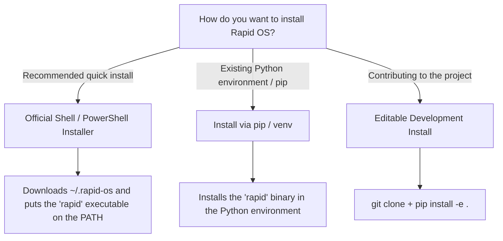

# Installing Rapid OS

Rapid OS is distributed as a command-line tool (`rapid` or `python rapid.py`). The governance core is implemented entirely in Python and requires no mandatory external dependencies for basic operation.

---

## Choose your installation method

There are two main ways to install Rapid OS depending on your workflow:



### 1. Quick installer per operating system (Recommended)

The automated installers clone the repository into `~/.rapid-os`, pin the stable version, and install a `rapid` executable on your PATH. This is the recommended method if you are going to use shortcuts or hooks: agents only find `rapid` if it is an executable on the PATH, not an alias or a `venv` activated in another terminal.

- **[Windows installation](./windows.md):** PowerShell script optimized for Windows 10/11.
- **[Linux installation](./linux.md):** Bash script compatible with Ubuntu, Debian, Fedora, Arch, and derivatives.
- **[macOS installation](./macos.md):** Compatible with Apple Silicon (M1/M2/M3/M4) and Intel.
- **[WSL installation](./wsl.md):** Specific guide for Windows Subsystem for Linux.

### 2. Installing with `pip` in a virtual environment

If you prefer to manage Rapid OS inside a Python virtual environment (`venv`):

```bash
# Create and activate a virtual environment
python -m venv .venv
source .venv/bin/activate  # On Windows: .venv\Scripts\Activate.ps1

# Install from the repository or package
python -m pip install git+https://github.com/alyconr/Rapid-OS.git@v3.1.1
```

---

## Shortcuts in your user folder

Since version 3.2.0, `rapid shortcuts install --global --harness <id>` installs `/rapid-init` and the other `/rapid-*` shortcuts once for all your projects (Claude Code, Codex, Cursor, and Antigravity; VS Code does not support it: `RAPID1413`), and the installers ask about it at the end if the installed `rapid` supports it. The stable `v3.1.1` version does not have it and its installer does not offer it. Check the result in [Verification](./verification.md) (`RAPID1414` if `rapid` is not on the `PATH`).

## Difference between Stable and Development versions

:::info Installation channels
- **Stable version (`v3.1.1`):** Pinned to the official tag [`v3.1.1`](https://github.com/alyconr/Rapid-OS/releases/tag/v3.1.1). Recommended for production and development teams.
- **Development version (`main`):** Obtained by checking out the `main` branch under active development. Contains the latest features before formal packaging.
:::

---

## Next steps

1. Review the [System requirements](./requirements.md).
2. Follow the guide for your operating system.
3. Run the [Installation verification](./verification.md) to check that the CLI responds correctly.
4. Install the shortcuts in your project with `rapid init --shortcuts` (or `rapid shortcuts install` in an already initialized project) and follow [Getting started](../getting-started.md).
