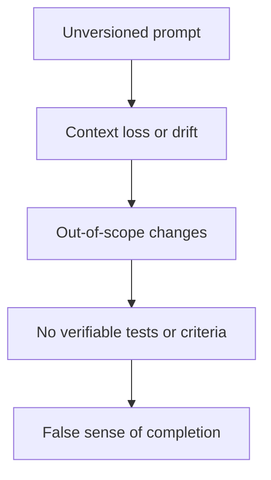

# Why Rapid OS

AI coding harnesses are transforming implementation speed. In real engineering teams, however, speed without control amplifies technical risk.

Rapid OS addresses the gap between **probabilistic model inference** and **deterministic software engineering assurance**.

## The problem: limits of agent-based development

When developers use coding harnesses such as Codex, Claude, Cursor, Antigravity, or VS Code Agent, recurring structural problems arise:

### 1. Context loss and drift

Language models have finite context windows. When given an entire repository or unstructured instructions, they may forget architecture rules, generate code incompatible with project library versions, or invent assumptions when information is missing.

### 2. Ambiguous specifications and volatile prompts

A conversational prompt in a chat window is not an engineering specification. It is not versioned in Git, does not formally define acceptance criteria, and does not delimit what is out of scope.

### 3. Scope creep

An agent asked to fix a login form may refactor adjacent components, change dependencies unnecessarily, or alter public API contracts, introducing hard-to-detect regressions.

### 4. Lack of verifiable evidence

An agent saying "I completed the task and all tests pass" is not technical proof. Tests may never have run, critical checks may be skipped, and there may be no cryptographic record of which files changed or what commands actually returned.

## The value: contract-driven governance

Rapid OS adds a **deterministic governance and control layer** around coding harness work without interfering with its generative capability.

| Capability | Without Rapid OS | With Rapid OS v3 |
|---|---|---|
| Repository intelligence | Agent inspects files at random. | `rapid scan` extracts typed facts with provenance and evidence (`ProjectModel`). |
| Specification | Ephemeral chat prompts. | `rapid spec` manages immutable specifications versioned in Git. |
| Context | Unbounded data dump. | `rapid context` compiles relevant, prioritized context with a strict character limit. |
| Execution rules | Agent operates without explicit constraints. | `rapid policy` and `rapid run` set risk, workspace requirements, and mandatory gates. |
| Harness capabilities | Assumes the agent can do everything. | `rapid harness` compares required permissions with declared capabilities. |
| Verification | Blind trust in the LLM's response. | `rapid evidence` and `rapid eval` assess reproducible execution evidence with deterministic rules. |

## Who Rapid OS is for

- **Individual developers:** Structure complex tasks, keep agents from changing unrelated areas, and compile the exact context for each request.
- **Technical leads and architects:** Preserve architecture, control dependencies, and define immutably what is allowed in each iteration.
- **Engineering and DevOps teams:** Maintain traceability from intent to spec, code diff, and test results for every AI-generated change.
- **QA and compliance teams:** Audit what happened during a task using SHA-256 traceability and deterministic evaluations independent of any LLM.
