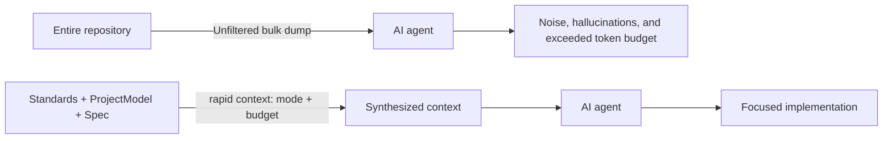

# What the Agent Knows About Your Project

An agent without context improvises: it invents business rules, mixes architectural styles, and forgets past decisions. Rapid OS gives it only what it needs for each task.

## With shortcuts

You do not need to do anything; the agent receives context for each task from three sources:

| What | Where it comes from | Where it lives |
|---|---|---|
| **Project documents:** brief, business rules, data model, architecture | Decisions made during `/rapid-init` (provided, drafted by the agent, or skipped) | `docs/` |
| **Standards:** stack, architecture, security, coding style | Generated by Rapid OS from your onboarding decisions | `.rapid-os/standards/` and your agent file (`CLAUDE.md`, `AGENTS.md`, and others) |
| **Current task spec** | Drafted by the agent from your request | `.rapid-os/specs/` |

### Drafts and confirmed documents

The agent treats what you **confirmed** as a project rule and follows it without question. What remains a **draft** (agent-written and unconfirmed) is treated as an assumption: the agent may question it, and each task reminds you. To confirm one later:

```bash
rapid setup doc business --confirm
```

Replace `business` with `brief`, `data-model`, or `architecture` as needed.

### Change a document

Rapid OS writes documents in `docs/` through `rapid setup doc`; do not edit them manually. To reopen a skipped document:

```bash
rapid setup doc business --reopen
```

Then enter `/rapid-init` in your agent; it offers to have you provide it, draft it, or skip it. To replace a document with existing content, see [Project Documents and Provenance](../concepts/project-docs.md).

<details>
<summary>What the agent does behind the scenes</summary>

When `rapid start <mode> --spec-file -` runs, Rapid OS creates the run contract with its spec and project standards. The shortcut tells the agent to work only on the task returned by `rapid next --json` (`implement_task`). To inspect the exact context a harness would receive (for debugging or CI), use `rapid context` as described in advanced mode.

</details>

## Advanced mode

You do not need this with shortcuts. This section describes the context compiler (`rapid context`): budgets, relevance, manifests, and provenance, useful for debugging and CI.

<details>
<summary>View the context compiler</summary>

### Why not dump the entire repository?



### Main `rapid context` options

| Flag | Type | Description |
|---|---|---|
| `--mode` | string | Task mode: `feature`, `bugfix`, `refactor`, `hardening`, `research`, or `general`. |
| `--spec` | string | Include a ready spec by ID. |
| `--harness` | string | Target harness, such as `codex`, `claude`, `cursor`, `vscode`, or `antigravity`. |
| `--objective` | string | Explicit goal used to refine relevance. |
| `--max-chars` | integer | Maximum characters in the resulting Markdown. |
| `--manifest` | flag | Print a readable provenance summary (`ContextManifest`). |
| `--json` | flag | Emit the structured `CompiledContext` as JSON. |

### Example: compile context for a feature

For a ready spec named `api-rate-limiting`:
```bash
rapid context --spec api-rate-limiting --manifest
```

Use `--mode`, `--harness`, or `--max-chars` to adjust mode, target agent, and budget.

The command writes a structured Markdown document to stdout containing project directives from `.rapid-os/standards/`, scan facts relevant to the mode, the active spec's goals and tasks, and (with `--manifest`) a provenance summary.

## Context manifest (`ContextManifest`)

Each compilation produces a content hash (`content_digest`). When `rapid run create` later creates a run, the digest is immutably recorded in the execution contract (`ExecutionContract.context_digest`). This lets the team reproduce exactly which information and directives the agent saw when work was performed.

</details>
