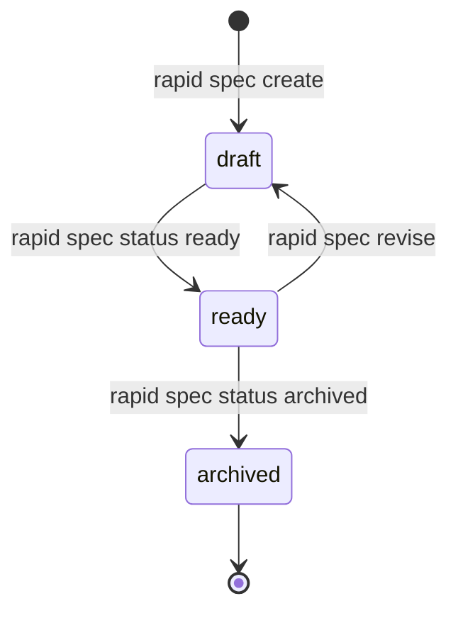

# How the Spec Is Written

Every task starts with a **spec**: a short document that says what will be built and how to tell when it is done. It keeps the agent from improvising or going out of scope.

## With shortcuts

**You do not write it yourself.** Describe the work and the agent drafts it:

```text
/rapid-feature add CSV export to the monthly report
```

Your request should clarify these four parts of the spec:

| Part | Example |
|---|---|
| **Goal:** why | Share the monthly report outside the app |
| **Scope:** what is included and excluded | The monthly report only; not the weekly one |
| **Acceptance criteria:** how to tell it works | The report downloads as a CSV with the same columns shown on screen |
| **Tasks:** the steps | `T001` Add CSV export; `T002` Add the button |

If your request does not provide enough detail for a part, the agent asks before drafting. A request with a specific criterion ("with the same columns shown on screen") produces a better spec than a generic one ("improve the report").

If the project brief has stories (`- [ ] H001: ...`), enter `/rapid-feature` by itself. The agent suggests the next story and waits for your confirmation.

Once written, the spec is **frozen** for that task. If you change your mind partway through, cancel the task and request a new one (see [When the Agent Stops](./when-the-agent-stops.md)).

<details>
<summary>What the agent does behind the scenes</summary>

1. The shortcut runs `rapid next --json`. With no active run, the action is `author_spec` and includes `action.spec_template`, the mode template (title, business goal, problem, scope, acceptance criteria, tasks, and more).
2. The agent drafts the spec from your goal **using that template** and sends it through stdin to `rapid start <mode> --spec-file -`. The aliases `acceptance` and `tasks` are accepted in place of `acceptance_criteria` and `implementation_tasks`.
3. `rapid start` creates the spec, contract, and run, then returns the next action (usually the baseline).

```bash
echo '{"title": "Export report to CSV", "business_objective": "Share the monthly report", "problem_statement": "It can only be viewed on screen today", "acceptance_criteria": ["The report downloads as a CSV"], "tasks": ["T001: Add export_csv to the report"]}' | rapid start feature --spec-file - --json
```

With no active run, `rapid next` only knows the `feature` template; other shortcuts get their template from `rapid start <mode> --json`. See the complete loop in the [shortcuts guide](../guides/shortcuts.md#4-the-shortcut-loop).

</details>

## Advanced mode

You do not need this when using shortcuts. This is how to create specs manually with `rapid spec`, useful in CI or for auditing.

<details>
<summary>View the spec workflow with v3 commands</summary>

Each spec lives in `.rapid-os/specs/<spec-id>/`. Create one with a title and tasks; its ID is derived from the title, and its mode defaults to `feature` (change it with `--mode`):

```bash
rapid spec create --title "API Rate Limiting" --task "T001: Create the rate limit middleware"
rapid spec status api-rate-limiting ready
```

A spec starts as `draft` and can enter a run only when it is `ready`. Add other fields (goal, scope, acceptance criteria, and more) with a revision. Revisions never overwrite earlier ones and return the spec to `draft`:

```bash
rapid spec revise api-rate-limiting --acceptance "Respond with HTTP 429 after 5 failed attempts"
rapid spec status api-rate-limiting ready
```

To inspect specs:
```bash
rapid spec list
rapid spec show api-rate-limiting
```



All fields (`--objective`, `--scope`, `--out-of-scope`, `--acceptance`, `--task`, and more) are in the [`rapid spec` reference](../cli.md#spec-registry-rapid-spec).

</details>
