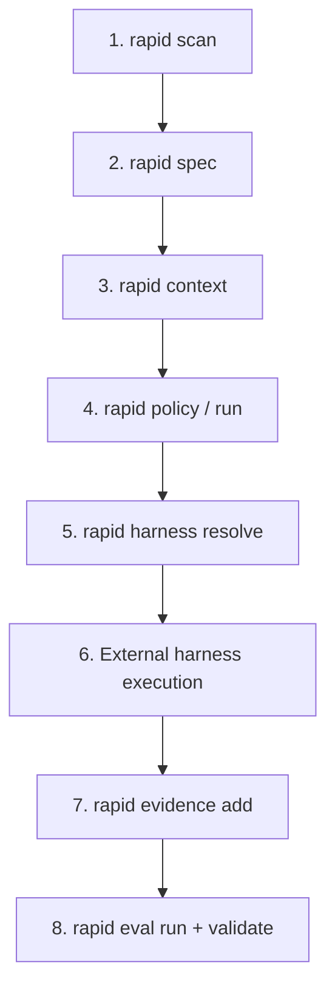

# Next Steps

You know the essentials: run `/rapid-init` once per project, use `/rapid-<mode>` for each task, and run `rapid approve` when the agent asks. Choose where to go next.

## Practice with the labs

Five small projects, one for each mode, all using the same four-step workflow. Start with [Feature](../tutorials/feature-lab.md), then try [Bugfix](../tutorials/bugfix-lab.md). See all of them in [Hands-on Labs](../tutorials/index.md).

## Choose the right mode

| If you want to... | Use | What Rapid OS requires |
|---|---|---|
| Build something new | `/rapid-feature` | Passing tests and your final approval |
| Fix a bug | `/rapid-bugfix` | A test that reproduces the bug before it is fixed |
| Restructure code without changing behavior | `/rapid-refactor` | No decrease in the passing test count |
| Improve security | `/rapid-hardening` | Work in an isolated copy and human review |
| Investigate or compare options | `/rapid-research` | Recorded findings; tests are not required |

Each mode has a guide in [Engineering Modes](../guides/modes/index.md).

## Work as a team

- **Version shortcuts with the repository** so everyone uses the same workflow: run `rapid init --shortcuts` at the project root to generate them in each agent's directory (`.claude/skills/`, `.agents/skills/`, and others).
- **After upgrading Rapid OS**, rerun the command you used to install shortcuts (`rapid shortcuts install --global --harness <agent>`, or `rapid shortcuts install` inside the project) to refresh changed files.
- **In CI**, advanced-mode commands verify work without an agent; see [CI/CD Integration](../guides/ci-cd-integration.md).

## If something fails

Rapid OS messages include a `RAPIDxxxx` code. Look it up in the [diagnostics catalog](../troubleshooting/diagnostics.md); common shortcut issues are in [Troubleshooting the Labs](../troubleshooting/tutorials.md).

## Advanced mode

You do not need this when using shortcuts. To understand what Rapid OS records at each step (contracts, evidence, evaluation), here is the full workflow using v3 commands.

View the governance loop

### The eight-phase loop

### Advanced governance stages

1. **Execution policies (`rapid policy`):** Set team risk and operating rules in `.rapid-os/policy.json`, including which risk levels (`low`, `medium`, `high`, `critical`) require isolated workspaces and which quality gates are mandatory.
2. **Run contracts and lifecycle (`rapid run`):** Create a run with `rapid run create --spec <spec-id> --harness <harness-id>`. This creates an immutable `ExecutionContract` and opens the `RunState` ledger to track tasks (`T001`...) and gates (`gate.tests`...).
3. **Capability resolution (`rapid harness`):** Use `rapid harness resolve` to check whether the selected agent profile declares support for the contract's required operations. If the contract requires file changes and the harness does not declare `repository.write`, the process reports incompatibility before starting.
4. **Evidence ingestion (`rapid evidence`):** After the agent's work, collect execution results (command logs, test reports, Git diffs) with `rapid evidence add`. Files are copied to `.rapid-os/evidence/<run-id>/artifacts/` with their size and immutable SHA-256 hash.
5. **Deterministic behavioral evaluation (`rapid eval`):** Run `rapid eval run --run <run-id>`. The engine checks collected evidence and returns `PASS`, `PASS_WITH_WAIVERS`, `UNVERIFIED`, or `FAIL`, so no task is considered complete without demonstrable evidence.

### Recommended resources

- [Detailed v3 Governance Loop](../governance-loop.md): State transitions, cross-hashes, and logical rules.
- [Harness Capabilities and Permissions](../guides/permissions-capabilities.md): Canonical capability catalog and AI tool profiles.
- [Project Layout and Boundaries](../guides/project-layout.md): Directories Rapid OS creates and which ones are immutable.
- [Full CLI Reference](../cli.md): Commands, arguments, options, and exit codes for `rapid`.
- [Rapid OS v3 Architecture](../architecture/rapid-os-v3.md): Technical specification for architects and integrators.

