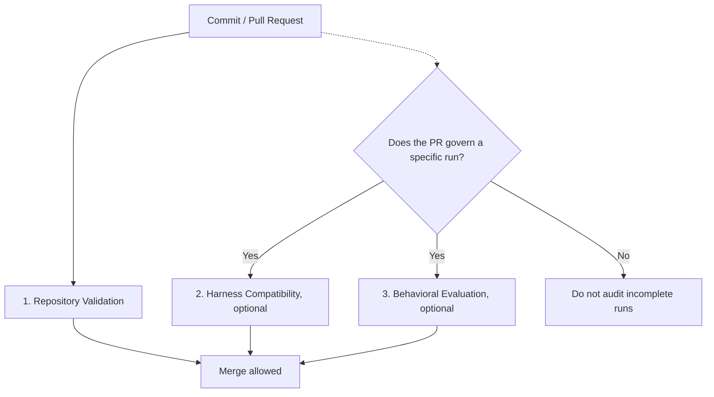

# CI/CD Integration

Rapid OS governs local work by developers and coding harnesses. Its standardized exit codes and deterministic JSON output (`--json`) also make it suitable for CI/CD pipelines such as GitHub Actions, GitLab CI, and Bitbucket Pipelines.

## Independent CI gates

A pipeline can include three independent controls, depending on the workflow stage:



## 1. Repository integrity validation (baseline control)

This control is **universal and safe for any repository or PR**. It does not assume there are active runs or prior evidence. It checks templates, the Project Intelligence snapshot, specifications, and configuration for errors:

```bash
rapid validate --strict
```

- **Exit code `0`:** The repository is fully consistent, with no diagnostic errors or warnings.
- **Exit code `1`:** At least one warning or error is present (blocks the pipeline).

## 2. Harness capability validation (run-specific control)

Use this when a PR is associated with a prepared run and the team uses declarative profiles with a lock file (`.rapid-os/capabilities.lock`):

```bash
# Requires TARGET_RUN_ID and capabilities.lock
rapid harness resolve --run "$TARGET_RUN_ID" --locked --require-compatible
```

- **Exit code `0`:** The harness meets every capability required by the contract.
- **Exit code `1`:** An incompatibility was found (`RAPID1110`).

## 3. Behavioral evaluation gate (completion control)

Apply this **only to the specific run completed in the PR**.

> **Product truth warning:** Never run `rapid eval run --require-pass` blindly across every directory in `.rapid-os/runs/`. It may contain prepared, paused, cancelled, or historical runs that legitimately do not yet have complete evidence. Explicitly target the `TARGET_RUN_ID` for the current change.

```bash
# Requires a completed TARGET_RUN_ID with external execution and registered evidence
rapid eval run --run "$TARGET_RUN_ID" --require-pass
```

- **Exit code `0`:** Verdict is `PASS` or `PASS_WITH_WAIVERS`.
- **Exit code `1`:** Verdict is `UNVERIFIED` (`RAPID1225`) or `FAIL` (`RAPID1226`).

## Example: GitHub Actions workflow

Reference workflow using **minimum permissions** (`contents: read`):

```yaml
name: RAPID OS Governance & Integrity Check

on:
  pull_request:
    branches: [main, develop]
  push:
    branches: [main]

permissions:
  contents: read

jobs:
  governance-validation:
    name: Repository Integrity Validation
    runs-on: ubuntu-latest
    steps:
      - name: Checkout repository
        uses: actions/checkout@v4
      - name: Set up Python
        uses: actions/setup-python@v5
        with:
          python-version: "3.12"
          cache: "pip"
      - name: Install RAPID OS
        run: pip install .
      - name: Verify RAPID OS installation
        run: |
          rapid --version
          rapid doctor
      - name: Validate repository integrity (strict)
        run: rapid validate --strict
      - name: Evaluate target governed run (if specified)
        if: env.TARGET_RUN_ID != ''
        env:
          TARGET_RUN_ID: ${{ vars.TARGET_RUN_ID }}
        run: |
          echo "Auditing specific run: $TARGET_RUN_ID"
          rapid eval run --run "$TARGET_RUN_ID" --require-pass
```

## Pre-commit hooks

Add strict Rapid OS validation to `.pre-commit-config.yaml` to check configuration and specs before local commits:

```yaml
repos:
  - repo: local
    hooks:
      - id: rapid-validate
        name: RAPID OS Integrity Check
        entry: rapid validate --strict
        language: system
        pass_filenames: false
```
