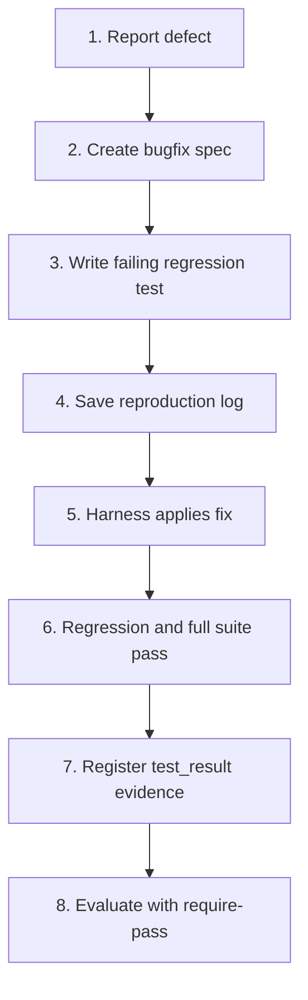

# Bugfix Mode

**Bugfix** mode prioritizes verifiable reproduction, narrow scope to prevent side effects, and a required regression test before declaring a defect fixed.

## With the `/rapid-bugfix` shortcut

```text
/rapid-bugfix the 10% discount returns a negative total
```

In Codex, use `$rapid-bugfix ...`. The shortcut guides the full run; see the [shortcuts guide](../shortcuts.md) for installation and harness invocation.

The playbook (`templates/modes/bugfix.json` and the Conductor rules) works as follows:

- The baseline is taken at `rapid start`, **before** the reproduction test exists.
- The first task (`T001`) is "Reproduce with a failing test." While it is in progress and there is no passing `reproduction.T001` assertion, `rapid next` proposes `rapid check --expect fail --task T001 -- <test_command>`, which records the expected failure as evidence.
- **Architecture:** If `.rapid-os/standards/architecture.json` exists (created during onboarding for the selected stack), the contract includes the required, non-waivable machine gate `gate.architecture`; `rapid next` proposes `rapid check --gate gate.architecture -- rapid arch check`. A layer or public-contract violation returns `RAPID1420`, and `rapid finish` will not return `PASS` until the code is corrected. See [Stack Architecture](../../concepts/architecture.md#the-gate-gatearchitecture).
- After recording the failure, close `T001` with `rapid task done T001 --no-check` (the suite is intentionally failing); implement the fix in subsequent tasks.

The remaining guide describes the same workflow with v3 commands (**Advanced Mode**), useful for CI, debugging, and auditing.

## Bugfix principles

1. **No fix without a regression test:** Reproduce each defect first with a test that fails.
2. **Narrow scope:** Limit the patch to the root cause; do not add opportunistic refactors.
3. **Evidence of no regression:** Record evidence that the full test suite still passes.

## Step-by-step workflow



### 1. Create the bugfix spec

```bash
rapid spec create \
  --title "Fix timeout in balance reconciliation" \
  --mode bugfix \
  --objective "Fix concurrency deadlock in balance queries" \
  --scope "Reconciliation service and transactional SQL queries" \
  --acceptance "Concurrent stress test passes without deadlocks in <500ms" \
  --task "1. Reproduce the deadlock in an integration test" \
  --task "2. Apply SELECT ... FOR UPDATE SKIP LOCKED" \
  --task "3. Verify no regression in overall balance" \
  --status ready
```

### 2. Compile context focused on the defect

```bash
rapid context \
  --spec fix-timeout-in-balance-reconciliation \
  --harness codex \
  --mode bugfix \
  --path "services/reconciliation" \
  --path "tests/integration/test_reconciliation.py" \
  --manifest
```

### 3. Create the run and bind policy

```bash
rapid run create --spec fix-timeout-in-balance-reconciliation --harness codex --classification bounded --risk medium
```

### 4. Capture reproduction and resolution evidence

During local reproduction, save the failure trace as a local diagnostic artifact, but do not register it as a run `test_result` tied to a task or gate. The current evaluator classifies any `test_result` with a nonzero exit code or failures as an irreversible run failure:

```bash
pytest -k test_reconciliation_deadlock > reproduction.log 2>&1 || true
```

> **Governance note (roadmap):** PR 2.1 will add formal support for contracts with `expectation: fail` for prior reproduction tests. Until then, keep the failing log as a local diagnostic artifact (`reproduction.log`) and do not bind it to a gate or task.

Once the fix is applied and all tests pass, create valid `test_result` evidence with `exit_code: 0`, then register it:

```bash
rapid evidence add --run fix-timeout-in-balance-reconciliation-r1-run-001 --input resolution-evidence.json
```

### 5. Evaluate the run

```bash
rapid eval run --run fix-timeout-in-balance-reconciliation-r1-run-001 --write --require-pass
```

The verdict confirms that `implementation_tests` was satisfied with empirical evidence.
