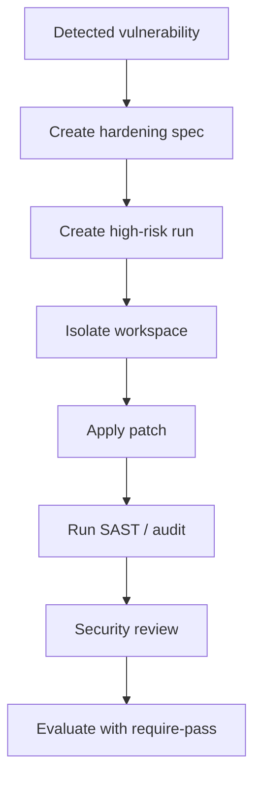

# Hardening Mode

**Hardening** mode governs sensitive work: patching vulnerabilities (CVEs), updating critical dependencies, strengthening authentication or cryptography policies, and auditing code infrastructure for security.

## With the `/rapid-hardening` shortcut

```text
/rapid-hardening validate and bound register_user inputs
```

In Codex, use `$rapid-hardening ...`. The shortcut guides the full run; see the [shortcuts guide](../shortcuts.md) for installation and harness invocation.

The playbook (`templates/modes/hardening.json` and Conductor rules) works as follows:

- At `high` risk, the contract requires an isolated workspace and `gate.review` (which can be waived), as well as baseline, tests, and final verification.
- Report each finding with its **CWE**, **CVSS v4.0** vector (`CVSS:4.0/...`), resulting severity, and the rule in `.rapid-os/standards/security.md` that covers it (the security baseline's "Findings: CWE and CVSS" section). Fix critical and high findings before release. See the [Security Baseline](../../concepts/security-baseline.md).
- `rapid start hardening --spec-file - --worktree` creates a Git worktree at `../<repo>-<run-id>` on branch `rapid/<run-id>`. The ledger stays in the main repository, `rapid check` runs in the worktree, and `rapid finish` takes changes from there. Without the flag, `rapid next` proposes `rapid start --resume --worktree`.
- The worktree starts from `HEAD` (uncommitted changes in the main checkout are not included), and `rapid abort` does not remove it.

The remaining guide describes the workflow with v3 commands (**Advanced Mode**), useful for CI, debugging, and auditing.

## Hardening mode characteristics

- **Elevated risk:** Typically `high` (80) or `critical` (100).
- **Workspace isolation:** Policy may require an isolated environment or branch/worktree (`isolated_required`).
- **Required gates:** `security_review` (formal security approval), `peer_review` (human peer review), and `final_verification` (static audit or vulnerability scan with no critical findings).



## Advanced workflow

Create a hardening spec and compile security-focused context:

```bash
rapid spec create \
  --title "Mitigate XML parser CVE and sanitize inputs" \
  --mode hardening \
  --objective "Update XML parser vulnerable to XXE and restrict arbitrary deserialization" \
  --scope "parsers/xml module and pyproject.toml dependencies" \
  --acceptance "Defensive libraries updated, no SAST alerts, injection tests blocked" \
  --task "1. Update the defensive library" \
  --task "2. Configure defusedxml to disable external entities" \
  --task "3. Add simulated XXE attack tests" \
  --status ready

rapid context --spec mitigate-xml-parser-cve --harness claude --mode hardening \
  --constraint "Do not use parsers without strict validation" --manifest
```

Create an isolated high-risk run:
```bash
rapid run create --spec mitigate-xml-parser-cve --harness claude --classification architectural --risk high
```

The contract enables `security_review` and `workspace_isolation`. Register SAST output as `command_result` evidence and the human security approval as `review` evidence, then acknowledge the gate and evaluate:

```bash
rapid evidence add --run mitigate-xml-parser-cve-r1-run-001 --input sast-evidence.json
rapid evidence add --run mitigate-xml-parser-cve-r1-run-001 --input review-evidence.json
rapid run gate mitigate-xml-parser-cve-r1-run-001 security_review acknowledged --reason "Approved by the security team"
rapid eval run --run mitigate-xml-parser-cve-r1-run-001 --write --require-pass
```

The final verdict certifies that security requirements and linked evidence satisfy execution policy before deployment.
