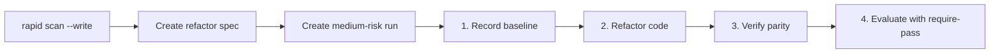

# Refactor Mode

**Refactor** mode governs changes to internal code structure (simplification, decoupling, performance, or technical-debt removal) while preserving external contracts and observable behavior.

## With the `/rapid-refactor` shortcut

```text
/rapid-refactor separate commission calculation from output formatting
```

In Codex, use `$rapid-refactor ...`. The shortcut guides the full run; see the [shortcuts guide](../shortcuts.md) for installation and invocation by harness.

The playbook (`templates/modes/refactor.json` and Conductor rules) works as follows:

- A baseline is required (`gate.baseline`); it is the no-regression reference.
- **Architecture:** If `.rapid-os/standards/architecture.json` exists (created during onboarding for the selected stack), the contract includes the required, non-waivable machine gate `gate.architecture`. `rapid next` proposes `rapid check --gate gate.architecture -- rapid arch check`. A layer or public-contract violation returns `RAPID1420`; `rapid finish` will not return `PASS` until the code is corrected. See [Stack Architecture](../../concepts/architecture.md#the-gate-gatearchitecture).
- When all tasks are complete, if the latest `test_result` has fewer passing tests than the baseline, `rapid next` returns `blocked` and shows the difference. A refactor cannot reduce the passing test count.
- This is a Conductor rule (`rapid_os/orchestration/conductor.py`), not an evaluator rule.

The rest of this guide describes the workflow with v3 commands (**Advanced Mode**), useful for CI, debugging, and auditing.

## Refactor rules of thumb in Rapid OS

1. **Behavior must remain invariant:** If existing functional tests need assertion changes to pass, this is not a pure refactor; it is a disguised functional change.
2. **Baseline required:** Capture a verified test state before changing the first line of code.
3. **Suite parity:** Run the same suite before and after with zero failures.

## Step-by-step workflow



### 1. Specify the refactor

Record the exact limits of the restructuring:
```bash
rapid spec create \
  --title "Decouple payment persistence layer" \
  --mode refactor \
  --objective "Extract an abstract repository to isolate the database from domain logic" \
  --scope "payments/ module and adapters/db/" \
  --acceptance "No changes to public service signatures; all 150 tests pass" \
  --task "1. Define PaymentRepositoryProtocol" \
  --task "2. Implement PostgresPaymentRepository" \
  --task "3. Inject the dependency into PaymentService" \
  --status ready
```

### 2. Start the run and record the baseline

```bash
rapid run create --spec decouple-payment-persistence --harness codex --classification bounded --risk medium
```

Run the full suite against the original code and add valid baseline `test_result` evidence (for example, 150 passed, zero failed, exit code 0):

```bash
rapid evidence add --run decouple-payment-persistence-r1-run-001 --input baseline-evidence.json
rapid run gate decouple-payment-persistence-r1-run-001 baseline_check acknowledged --reason "Baseline verified: 150 tests pass"
```

### 3. Run the refactor in the harness

Give your agent or coding assistant the instructions. Make sure it does not change existing contract tests.

### 4. Record post-change evidence and diff

Record `test_result` evidence showing the same passing count, plus `file_change` evidence listing the modified paths. Then evaluate:

```bash
rapid evidence add --run decouple-payment-persistence-r1-run-001 --input post-evidence.json
rapid evidence add --run decouple-payment-persistence-r1-run-001 --input files-evidence.json
rapid eval run --run decouple-payment-persistence-r1-run-001 --write --require-pass
```

The evaluator confirms that baseline and implementation tests have suitable evidence.
