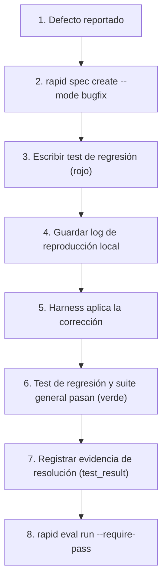

# Modo Bugfix

El modo **Bugfix** prioriza la reproducción verificable del error, la contención del alcance para evitar efectos secundarios y la adición obligatoria de una prueba de regresión antes de declarar resuelto el defecto.

---

## Con el shortcut `/rapid-bugfix`

```text
/rapid-bugfix el descuento del 10% devuelve un total negativo
```

(En Codex: `$rapid-bugfix …`.) El shortcut conduce el run completo; la instalación y la invocación por harness están en la [guía de shortcuts](../shortcuts.md).

Qué hace su playbook (`templates/modes/bugfix.json` y las reglas del Conductor):

- **Primero la causa (H-67).** Que un test pase no es un arreglo: un test contra un doble del componente defectuoso puede pasar con la causa intacta. Antes de redactar la spec el agente localiza la causa raíz sin editar archivos (`git blame`, `git log -S`, la traza de un test o la lectura del código) y la declara en `root_cause`: `file` (debe existir en el repositorio), `symbol` o `line`, `how_found` y `explanation`. Sin ella, o con un archivo que no existe, `rapid start bugfix` rechaza la spec con `RAPID1438` y dice qué falta.

  ```json
  "root_cause": {
    "file": "catalog/infrastructure/sqlalchemy_catalog_reader.py",
    "symbol": "_bookable",
    "how_found": "git log -S \"is_finite\"",
    "explanation": "`or amount <= 0` se cambió por `or not amount.is_finite()`: los precios cero o negativos pasaron a ser reservables"
  }
  ```

- Las tareas de la plantilla son, en orden: localizar y confirmar la causa (antes de escribir el test), reproducir con un test en rojo que **ejecute el código de `root_cause`** (si la causa está en un adaptador, en infraestructura o en la base de datos, un test de integración con los servicios levantados, no uno con dobles del componente defectuoso), corregir la causa y verificar con la suite completa.
- La baseline se toma en `rapid start`, **antes** de que exista el test de reproducción.
- La tarea de reproducción es la que dice que reproduce (`T001` en las specs anteriores a H-67). Mientras está en curso y no hay una aserción `reproduction.<tarea>` en PASS, `rapid next` propone `rapid check --expect fail --task <tarea>` (ejecuta `test_command`), que registra el fallo esperado como evidencia.
- **Cerrar la tarea de corrección** (la que sigue a la de reproducción) corre la suite en el árbol actual (debe pasar; `--no-check` no se la salta) y después la comprobación de la reproducción. Rapid OS crea un worktree git temporal con el árbol del baseline del run, enlaza las carpetas de dependencias (`node_modules`, `.venv`, `venv`) y copia `.env`, añade los archivos de test que el run añadió o cambió y corre allí `test_command` como lo hace `rapid check --gate gate.tests` (el mismo argv, sin shell; un comando de tests combinado, componente a componente). El worktree temporal se borra siempre.
  - **`holds`** solo cuando, en ese árbol, los tests del run hacen fallar más tests de los que fallan sin ellos. La comparación es con la evidencia de baseline del propio run (`gate.baseline`, tomada al iniciar sobre el mismo árbol sin los tests nuevos) o, si esa evidencia no tiene conteo, con una ejecución del árbol del baseline sin los tests del run. Los fallos se cuentan sumando un resumen por ejecutor en la salida (pytest, unittest, Vitest, Jest, Karma, `cargo test`, `go test -v`), así que un comando combinado (backend y frontend) se cuenta entero. Cuando el ejecutor nombra los tests fallidos (pytest `FAILED ruta::test`, Vitest/Jest `FAIL ruta`, unittest `FAIL: test (modulo.Clase.test)`), al menos uno debe ser de los archivos de test del run. El exit code solo nunca prueba la reproducción. El resultado queda como evidencia propia (`command_result` con la etiqueta `reproduction_holds`).
  - **`RAPID1439`, la tarea no se cierra**, cuando los tests del run no añaden ningún fallo allí (el test no reproduce el bug: otra parte de la suite que falla o un test que ya estaba en rojo no cuentan), cuando solo fallan otros tests («fallan otros tests en el baseline, no el de reproducción», con la lista) o cuando no cambió ningún archivo de test.
  - **No concluyente** (también `RAPID1439`) cuando la salida no tiene un resumen de tests que contar, por ejemplo porque los tests no pudieron correr en ese árbol, y también cuando un componente de un comando de tests combinado no dio resumen y otro sí (esa parte no llegó a ejecutar sus tests: contar solo la otra diría «0 fallidos» de tests que nunca corrieron). Entonces solo la persona puede dejar cerrar la tarea: `rapid task done <tarea> --accept-reproduction --reason "<motivo>"` en su propia terminal, después de leer el log; pregunta `¿Aceptas la reproducción sin comprobar? [s/N]` y se rechaza desde una sesión de agente, bajo un ancestro de agente o sin TTY (`RAPID1310`), como `rapid approve` y `--accept-test-command`. La aceptación queda como evidencia `review` (`accepts: reproduction_inconclusive`) que muestran la entrega y `rapid eval show`. El agente nunca la ejecuta: el shortcut le dice que explique el log y dé el comando.
  - Un run que empezó sin commit no tiene árbol de baseline: la comprobación se omite con un aviso.
- **Qué prueba la comprobación y qué no.** Prueba que el test del run falla sin la corrección (en el árbol del baseline) y pasa con ella (en el árbol actual). No prueba que el test ejecute el código de `root_cause`: un test contra un doble del componente defectuoso puede fallar en el baseline y pasar tras una barrera puesta en otro sitio. Eso lo revisa la persona con la entrega: muestra la causa declarada, las líneas del diff que cambian su archivo, aparte las defensas adicionales, y el aviso cuando el diff no toca la causa.
- **Entrega.** En `await_human_approval`, `rapid next` muestra la causa declarada, las líneas del diff que cambian su archivo («corrección en la causa») y, aparte, los demás archivos de producción que cambió el run («defensas adicionales»), con la evidencia `reproduction_holds`; `--json` los pone en `action.bugfix` (`root_cause`, `fix_at_cause`, `additional_defenses`, `reproduction_holds`, `touches_root_cause`). Si el diff no toca el archivo de `root_cause`, avisa: `AVISO: el arreglo no toca la causa declarada`. El shortcut nombra la causa en la entrega y no entrega con ese aviso.
- **Arquitectura:** si el proyecto tiene `.rapid-os/standards/architecture.json` (lo escribe el onboarding con el stack elegido), el contrato incluye el gate de máquina `gate.architecture` (obligatorio, no dispensable) y `rapid next` propone `rapid check --gate gate.architecture -- rapid arch check`. Una violación de capas o de contrato público es `RAPID1420` y `rapid finish` no da `PASS` hasta que se corrija el código. Detalle en [Arquitectura por stack](../../concepts/architecture.md#el-gate-gatearchitecture).
- Con el fallo registrado, la tarea de reproducción se cierra con `rapid task done <tarea> --no-check` (la suite está en rojo a propósito) y la corrección va en la tarea siguiente.

El resto de esta guía describe el mismo ciclo con comandos v3 (**Modo avanzado**), útil para CI, depuración y auditoría.

---

## Principios del modo Bugfix

1. **No hay fix sin prueba de regresión**: Todo defecto debe reproducirse primero mediante una prueba que falle.
2. **Alcance mínimo**: El parche debe limitarse estrictamente a corregir la causa raíz sin introducir refactorizaciones oportunistas.
3. **Evidencia de no-regresión**: Se debe registrar evidencia de que la suite general de pruebas sigue aprobando al 100%.

---

## Flujo paso a paso



---

## 1. Registrar la especificación del Bugfix

```bash
rapid spec create \
  --title "Fix timeout en reconciliación de balance" \
  --mode bugfix \
  --objective "Corregir bloqueo por concurrencia en la consulta de saldos" \
  --scope "Servicio de reconciliación y queries SQL transaccionales" \
  --acceptance "Test de estrés concurrente pasa sin interbloqueos en <500ms" \
  --root-cause-json '{"file": "services/reconciliation/balance_query.py", "symbol": "fetch_balances", "how_found": "traza del test", "explanation": "lee los saldos sin bloqueo de filas"}' \
  --task "1. Reproducir el deadlock en test de integración" \
  --task "2. Aplicar SELECT ... FOR UPDATE SKIP LOCKED" \
  --task "3. Verificar ausencia de regresión en balance general" \
  --status ready
```

---

## 2. Compilar el contexto con foco en el defecto

```bash
rapid context \
  --spec fix-timeout-en-reconciliacion-de-balance \
  --harness codex \
  --mode bugfix \
  --path "services/reconciliation" \
  --path "tests/integration/test_reconciliation.py" \
  --manifest
```

---

## 3. Crear el Run y vincular la política

```bash
rapid run create \
  --spec fix-timeout-en-reconciliacion-de-balance \
  --harness codex \
  --classification bounded \
  --risk medium
```

---

## 4. Capturar Evidencia de Reproducción y Resolución

### Paso A: Evidencia del fallo inicial (Reproducción local)
Captura la traza y resultado del fallo como artefacto de reproducción local sin registrarlo todavía como `test_result` ligado a tareas o compuertas del run (ya que el evaluador actual clasificaría cualquier `test_result` con `exit_code != 0` o `failed > 0` como fallo irreversible del run):

```bash
# Ejecutar test de reproducción y almacenar el log rojo como artefacto local
pytest -k test_reconciliation_deadlock > reproduction.log 2>&1 || true
```

> **Nota de Gobernanza (Roadmap):** El PR 2.1 introducirá soporte formal de contratos con `expectation: fail` para pruebas de reproducción previa. Hasta entonces, conserva el log de falla como artefacto local de diagnóstico (`reproduction.log`) y no lo vincules como evidencia de compuertas ni tareas.

### Paso B: Evidencia de la corrección y no-regresión
Una vez aplicado el cambio en el código y aprobadas todas las pruebas:

```json
{
  "kind": "test_result",
  "producer": "pytest-full-suite",
  "summary": "Suite completa verde incluyendo nuevo test de regresión",
  "gate_ids": ["implementation_tests"],
  "payload": {
    "suite": "all-tests",
    "exit_code": 0,
    "passed": 48,
    "failed": 0,
    "skipped": 0
  }
}
```

```bash
rapid evidence add \
  --run fix-timeout-en-reconciliacion-de-balance-r1-run-001 \
  --input resolution-evidence.json
```

---

## 5. Evaluación final del Run

Ejecuta la evaluación final:

```bash
rapid eval run \
  --run fix-timeout-en-reconciliacion-de-balance-r1-run-001 \
  --write \
  --require-pass
```

El veredicto confirmará que las compuertas de pruebas (`implementation_tests`) fueron satisfechas con evidencia empírica.

